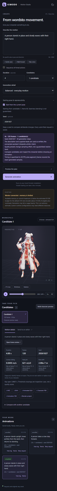
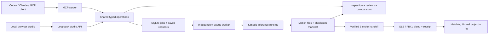

# Kimodo MCP & Motion Studio

**Describe a movement, generate skeletal animation locally, inspect the actual result, and bring it into Blender or Unreal Engine.**

Kimodo MCP connects [NVIDIA Kimodo](https://github.com/nv-tlabs/kimodo) to MCP-compatible assistants, including Codex and Claude, and provides a browser studio for the same workflow. It combines explicit animation planning, durable background jobs, reproducible candidates, motion diagnostics, interactive character previews, and checked editor handoffs.

The bridge uses a locally configured Kimodo runtime. It requires no OpenAI or Anthropic API key for motion generation. Your assistant client, model downloads, and editor installations are configured separately.


*An actual local studio session displaying a completed 120-frame waving motion on a separately supplied demonstration character. The screenshot shows real saved jobs and measured diagnostics. Character assets, model weights, credentials, and local project files are not included in this repository.*

[Getting started](#getting-started-on-windows) · [Studio workflow](#work-in-the-browser-studio) · [MCP tools](#mcp-tools) · [Architecture](#how-it-works) · [Limitations](#scope-and-limitations) · [Troubleshooting](#troubleshooting)

## What this project provides

| Capability | What you can do |
| --- | --- |
| Natural-language planning | Describe an action, choose duration and generation effort, and inspect an explicit request before submitting it. |
| Timed sequences | Supply up to eight self-contained action descriptions with explicit durations and exact planned frame counts. |
| Reproducible candidates | Generate one to four samples while preserving model, seed, prompts, constraints, and effective settings. |
| Saved revisions | Create a new version while retaining every setting you did not explicitly change. |
| Pose reuse | Select a completed SOMA frame and anchor another generation's initial pose and heading. |
| Background generation | Submit, follow stages, cancel, inspect logs, and return later without an open browser or assistant session. |
| Interactive viewer | Orbit, pan, zoom, fit the camera, play, pause, scrub, change speed, and toggle wireframe or skeleton display. |
| Motion review | Inspect exact frames from three fixed views, with contact sheets, hashes, physical-unit diagnostics, and explicit unavailable results. |
| Candidate comparison | Align compatible clips by frame offset and compare world positions or poses relative to the root. |
| Editor integration | Execute fixed Blender and Unreal handoffs, then check exported files, rig compatibility, and animation timing. |
| Downloads | Retrieve original motion, animated GLB, skeletal mesh/animation FBX, and Blender projects when available. |
| MCP interface | Use 26 typed tools over stdio or loopback Streamable HTTP, sharing local jobs across clients. |

**Character scope:** Kimodo generates motion on supported skeletons; it does not generate a new mesh. The fitted-character pipeline is tied to one inspected asset and its exact checksum. It is not a general automatic rigging system. New users can generate and review skeletal motion without that character. Unrelated characters need an appropriate rig and a separately validated retargeting workflow.

## Getting started on Windows

### 1. Install prerequisites

| Component | Requirement |
| --- | --- |
| PowerShell | Version 7 or newer for setup and launcher scripts. |
| Git, `uv`, CMake | Available on `PATH` for sources, Python environments, and native builds. |
| C++ toolchain | A working compiler, such as Visual Studio C++ build tools, for Kimodo's motion-correction extension. |
| Node.js | Version 22.12 or newer to build the studio. CI uses Node 24. |
| NVIDIA runtime | Compatible GPU/driver for the selected PyTorch build. Setup defaults to PyTorch 2.11.0 with CUDA 12.8 wheels. |
| Model access | Hugging Face access to the gated `meta-llama/Meta-Llama-3-8B-Instruct` encoder. |
| Memory and disk | Capacity for environments, checkpoints, cache, and outputs; sufficient available RAM and commit capacity for inference. |
| Optional editors | Blender with its local MCP connection; Unreal with the required project plugins and Python transport. |

The interface and bridge are lightweight compared with inference. A working page does not establish that the machine can load the encoder. Read [memory readiness](#memory-and-model-readiness) before downloading or generating.

### 2. Clone and install the runtime

```powershell
git clone https://github.com/jon-jc/kimodo-mcp.git
cd kimodo-mcp

.\scripts\setup_runtime.ps1 -DataDirectory "D:\KimodoData"
```

Setup creates separate `mcp-env` and `runtime` environments, installs the bridge, clones Kimodo outside this repository, and probes runtime imports. It does **not** download model weights or establish successful inference. Upstream is pinned to [`e1c219c99b4b94ba48be1fb6a1cbc64ecee4c954`](https://github.com/nv-tlabs/kimodo/tree/e1c219c99b4b94ba48be1fb6a1cbc64ecee4c954); an existing checkout must match and remain clean.

If native dependency fetching fails:

```powershell
.\scripts\setup_runtime.ps1 -DataDirectory "D:\KimodoData" -NativeDependencyFallback
```

After the normal build fails, this option installs pybind11 2.11.1 and pinned Eigen 3.4.0 sources externally, builds the extension separately, and uses upstream's extension-skip installation option. It does not replace a missing compiler or edit upstream source files.

Use `-UpstreamDirectory` for an existing reviewed checkout. `-PythonVersion` defaults to `3.12`; `-TorchVersion` defaults to `2.11.0`.

### 3. Authorize the encoder and first-run downloads

Obtain access on the [Llama encoder model page](https://huggingface.co/meta-llama/Meta-Llama-3-8B-Instruct), then sign in locally:

```powershell
$env:HF_HOME = "D:\KimodoData\cache\huggingface"
& "D:\KimodoData\runtime\Scripts\hf.exe" auth login

.\scripts\start_worker.ps1 -DataDirectory "D:\KimodoData" -UpstreamDirectory "D:\KimodoData\upstream-kimodo" -AllowDownloads
```

The worker fetches required models when a generation needs them. Authentication alone does not grant gated access. Keep credentials in local Hugging Face configuration, outside prompts, tool arguments, examples, and Git.

After the weights are cached, restart the worker without `-AllowDownloads` for offline operation. Download permission belongs to the worker environment. Starting an already running worker again does not change its settings.

### 4. Open the studio

```powershell
.\scripts\start_studio.ps1 -DataDirectory "D:\KimodoData" -UpstreamDirectory "D:\KimodoData\upstream-kimodo" -StartWorker -OpenBrowser
```

Open **[http://127.0.0.1:8768](http://127.0.0.1:8768)** if needed. The launcher builds missing interface files and starts the local server in the background. Use `-Build` after interface changes or `-Port 8769` for another port.

**This launcher expects both environments created by the full setup script.** A standalone `.venv` installation uses the manual route below. The launcher does not start Blender or Unreal or install an operating-system service. Restart the worker and studio after reboot or configuration changes.

## Bridge-only and manual installation

Use this route for adapter development, MCP connections, or an independently installed Kimodo runtime:

```powershell
python -m venv .venv
.\.venv\Scripts\python.exe -m pip install -e ".[dev]"

cd web
npm ci
npm run build
cd ..
```

The bridge supports Python 3.11 and newer. On macOS/Linux, use `.venv/bin/python` and install inference dependencies using the [pinned upstream guide](https://github.com/nv-tlabs/kimodo/blob/e1c219c99b4b94ba48be1fb6a1cbc64ecee4c954/docs/source/getting_started/installation.md). The complete inference/editor workflow was exercised on Windows; bridge CI does not establish compatibility for every GPU/editor combination.

Configure the same environment for the worker, studio, and MCP clients:

| Variable | Meaning |
| --- | --- |
| `KIMODO_DATA_DIR` | Shared jobs, reports, exports, and registrations outside this repository. |
| `KIMODO_REPO` | Absolute path to the reviewed upstream checkout. |
| `KIMODO_PYTHON` | Absolute path to Python with Kimodo and inference dependencies. |
| `TEXT_ENCODER_DEVICE` | `cpu` reduces GPU use by moving the encoder into system memory. |
| `HF_HOME` | Optional shared Hugging Face cache and local authentication directory. |
| `KIMODO_ALLOW_DOWNLOADS` | `1` permits first-run downloads; ordinary worker startup is offline. |
| `KIMODO_WORKER_MODE` | `service` is the independent worker; optional `child` mode follows the client process tree. |
| `KIMODO_JOB_TIMEOUT` | Waiting and execution limits, applied separately; default `3600` seconds. |
| `KIMODO_CHARACTER_FBX` | Optional source for the supported fitted-character profile. |
| `KIMODO_UNREAL_ENGINE` | Optional Unreal installation root containing `Engine`. |

Run these commands in separate terminals with those settings:

```powershell
# Terminal 1: keep the worker independent of the browser and assistant.
.\.venv\Scripts\python.exe -m kimodo_mcp.worker_service

# Terminal 2: from the repository root.
.\.venv\Scripts\python.exe -m kimodo_mcp.studio --web-directory web/dist
```

The default data directory is `%LOCALAPPDATA%\kimodo-mcp` on Windows or `~/.local/share/kimodo-mcp` otherwise. Use one shared directory for clients on the same GPU so they share the queue and generation lock.

## Work in the browser studio

1. **Describe the performance.** Include pace, direction, and starting context. Choose one action of 0.2–10 seconds, or enable **Sequence of timed actions** for two to eight explicit beats.
2. **Preview the plan.** Inspect frames, seed, candidates, effort, and notes. A blank studio seed becomes a fresh random seed, shown after planning. MCP briefs default to zero unless explicitly supplied.
3. **Generate and follow progress.** Submission saves a job immediately. History exposes stages, failures, cancellation, and worker logs.
4. **Choose a completed candidate.** Inspect its motion and diagnostics. **Build character preview** runs the registered character's checked Blender handoff; it does not substitute a fake preview for an unfinished job.
5. **Inspect the model.** Use the camera, timeline, speed, wireframe, and skeleton controls. The opening registered preview is a previously saved asset, not a new result.
6. **Review or compare.** Open the three-view review, or compare compatible clips at an explicit offset. Root-relative mode removes translation only; world mode retains travel and drift.
7. **Revise or reuse a pose.** Change a saved request deliberately, or pause a SOMA preview and enable **Start from the current pose** for another generation. Pose anchoring does not guarantee matching velocity or a seamless transition.
8. **Export.** Download available files, run Blender, or configure the exact Unreal project, Skeleton, SkeletalMesh, destination, and new animation name.

Draft, balanced, and detailed select **20**, **50**, and **80** sampling steps. More steps or candidates do not guarantee a better performance. The planner preserves descriptions and supplied beats; it does not contain a hidden language model that invents choreography or interprets vague edit requests.

<details>
<summary>View the responsive mobile layout</summary>



The interface adapts to narrow browser windows. It remains a local desktop workflow, not a remote phone-hosting service.

</details>

See [the full studio guide](docs/studio.md), [natural-language workflow](docs/natural-workflow.md), and [structured animation workflows](docs/animation-workflows.md).

## Connect Codex, Claude, or another MCP client

Launch MCP using the **bridge Python**, pointing it to the heavy runtime through environment settings. Clients using `mcpServers` can merge this entry into their existing configuration:

```json
{
  "mcpServers": {
    "kimodo": {
      "command": "D:\\KimodoData\\mcp-env\\Scripts\\python.exe",
      "args": ["-m", "kimodo_mcp"],
      "env": {
        "KIMODO_REPO": "D:\\KimodoData\\upstream-kimodo",
        "KIMODO_PYTHON": "D:\\KimodoData\\runtime\\Scripts\\python.exe",
        "KIMODO_DATA_DIR": "D:\\KimodoData",
        "TEXT_ENCODER_DEVICE": "cpu",
        "HF_HOME": "D:\\KimodoData\\cache\\huggingface"
      }
    }
  }
}
```

[Client setup](docs/clients.md) includes tested Codex registration, Windows-friendly Claude Code `add-json`, Claude Desktop settings, and troubleshooting. Keep machine-specific configurations outside Git.

Stdio is the default. For shared local HTTP:

```powershell
& "D:\KimodoData\mcp-env\Scripts\python.exe" -m kimodo_mcp --transport streamable-http --port 8767
```

Connect to `http://127.0.0.1:8767/mcp`. MCP uses **8767**; the studio uses **8768**. Both are local interfaces and provide no public multi-user authorization service.

Example assistant request:

> Check runtime readiness. Plan a four-second animation of a person standing in place and slowly waving with the right hand. Use one draft candidate and seed 42. Show the plan, generate it, inspect the completed motion, and create a frame review. Preserve the original request and artifacts when revising.

Blender and Unreal are separate connections. Registering `kimodo` alone does not install their connectors. A client can use all three; the studio invokes the bridge's fixed handoff operations.

## MCP tools

The server exposes **26 tools**. Submission is distinct from completed animation.

| Tool | Purpose |
| --- | --- |
| `list_models` | Exact model IDs, skeletons, formats, and reviewed revision. |
| `health_check` | Configuration and worker status; optional runtime/GPU probe without weight downloads. |
| `plan_animation` | Compile a description/timed beats into explicit settings, optionally anchored to a source pose. |
| `generate_animation` | Submit a brief with transparent effort, seed, and candidate settings. |
| `revise_animation` | Preview or submit a new version, retaining unchanged settings and parent-job lineage. |
| `extract_pose_constraint` | Extract a validated full-body or limb constraint from a canonical SOMA frame. |
| `validate_motion` | Check a structured request, frame plan, compatibility, and constraint shapes. |
| `generate_motion` | Submit an explicit request and return a durable job ID. |
| `get_job` | Read status, stage, request, context, and completed manifest. |
| `list_jobs` | List recent jobs shared through the data directory. |
| `cancel_job` | Request cancellation while preserving completed outputs. |
| `get_job_log` | Read bounded worker diagnostics with supported credential redaction. |
| `get_artifact` | Resolve a manifest-listed output with checksum and local reference. |
| `inspect_motion` | Inspect arrays, hierarchy, timing, bounds, and contact metadata. |
| `preview_motion` | Create a local interactive skeleton preview from completed NPZ. |
| `analyze_motion_quality` | Speed, acceleration, jerk, angular speed, bone drift, contact sliding, floor proxies, and seams. |
| `create_motion_review` | Offline three-view player, contact sheet, and numerical report. |
| `compare_motions` | Numerical and visual comparison at an explicit offset with matching rig/FPS. |
| `get_character_profile` | Describe the fitted rig and verify its operator-registered source. |
| `prepare_blender_handoff` | Prepare fixed Blender import/export for completed SOMA BVH. |
| `prepare_character_handoff` | Prepare fitting, skinning, and retargeting for the supported profile. |
| `execute_blender_handoff` | Execute the verified prepared script and validate exported results. |
| `get_handoff_report` | Read Blender export, timing, hierarchy, and deformation evidence. |
| `prepare_unreal_handoff` | Prepare animation-only import into an explicit project and existing rig. |
| `execute_unreal_handoff` | Run the verified script in the matching editor and verify the saved animation. |
| `get_unreal_report` | Read final asset, skeleton, timing, and track verification. |

Resources include `kimodo://models`, `kimodo://request-schema`, and `kimodo://jobs/{job_id}`. The `animation_workflow` prompt guides assistants through the lifecycle. The studio convenience action `build_character_preview` combines existing operations; it is not another MCP tool.

## Request examples

Pass this object to `plan_animation`, then `generate_animation` when ready:

```json
{
  "brief": {
    "description": "A person stands in place and slowly waves with the right hand.",
    "duration_seconds": 4.0,
    "quality": "draft",
    "candidates": 2,
    "seed": 42
  }
}
```

Give longer actions explicit beats:

```json
{
  "brief": {
    "description": "An approach followed by a friendly greeting.",
    "beats": [
      { "text": "A person walks forward at a relaxed pace.", "duration": 3.0 },
      { "text": "A person stands in place and waves with the right hand.", "duration": 3.0 }
    ],
    "quality": "balanced",
    "candidates": 1,
    "seed": 42
  }
}
```

For lower-level control, these files contain full `validate_motion`/`generate_motion` arguments:

| Example | Purpose |
| --- | --- |
| [simple-motion.json](examples/simple-motion.json) | Reproducible SOMA motion with NPZ and standard-T-pose BVH. |
| [action-sequence.json](examples/action-sequence.json) | Several timed prompts. |
| [root-waypoints.json](examples/root-waypoints.json) | Frame-indexed root waypoints. |
| [robot-motion.json](examples/robot-motion.json) | A G1 request with supported exports. |

## Models, coordinates, and formats

The catalog contains nine exact generation identifiers; `kimodo-soma-rp-v1.2` is the default.

| Skeleton | Model identifiers | Native output |
| --- | --- | --- |
| SOMA | `kimodo-soma-rp-v1`, `kimodo-soma-rp-v1.1`, `kimodo-soma-rp-v1.2`, `kimodo-soma-rp-ardyrep`, `kimodo-soma-seed-v1`, `kimodo-soma-seed-v1.1` | Kimodo NPZ, BVH. |
| Unitree G1 | `kimodo-g1-rp`, `kimodo-g1-seed` | Kimodo NPZ, MuJoCo CSV. |
| SMPL-X | `kimodo-smplx-rp` | Kimodo NPZ, AMASS NPZ. |

- Canonical motion uses **meters, +Y up, +Z forward** and zero-based frame indices.
- Generation plans use **30 FPS**. Requests allow eight segments, four samples, 100 steps, 32 constraint objects, and 512 constrained frames.
- SOMA predicts a reduced 30-joint representation and exports 77 joints. Expansion fills relaxed hand detail; it does not independently generate articulated fingers.
- BVH offsets/root translation use centimeters, with corresponding Blender scale conversion.
- FBX, GLB, and `.blend` come from the editor handoff, not the native generator.
- A 120-sample clip at 30 FPS has **4.0 seconds of sample playback** and a **3.966667-second first-to-last key span**. Compare Unreal's sequence span with the latter.

The [upstream review](docs/upstream-review.md) explains representation differences, benchmark limits, and source coverage. Single-clip review does not implicitly run the research benchmark.

## Blender and Unreal workflows

### Blender

For a generic SOMA skeleton, prepare a completed BVH, execute the fixed handoff, and inspect its report. It creates a separate scene and exports only its armature. The generic template requires a fresh session if `KimodoRig` already exists.

For the supported character, register its original FBX outside Git, then prepare and execute its handoff. **Build character preview** performs this managed workflow in the studio. Results include animated GLB, rest-pose mesh FBX, animation-only FBX, a separate Blender project, and a verification report. Originals remain preserved.

Changing the registration path does not make an unknown mesh supported. The demonstration character is not distributed. See [editor handoffs](docs/editor-handoffs.md) for registration, Blender MCP setup, units, and export verification.

### Unreal Engine

Import the exported character mesh first, establishing its actual Skeleton and SkeletalMesh. Configure the intended `.uproject`, those assets, a destination, and a new animation name. Prepare and execute the animation-only handoff using the same exact target.

The executor checks project/engine identity, checksums, rig hierarchy, destination, sampled keys, and tracks. It does not retarget an unrelated Skeleton or overwrite existing animations. Native Unreal MCP and Python remote execution are separate interfaces; native endpoint reachability does not prove Python import readiness.

The [editor guide](docs/editor-handoffs.md) covers plugins, loopback configuration, engine registration, and a separate validation-project helper. Manny, MetaHuman, Mixamo, and other rigs require explicit retargeting before matching-skeleton import.

## How it works



The bridge, studio, and inference runtime are separate processes. Discovery and planning do not load model weights. One worker consumes the shared queue, while a generation lock serializes GPU work. SQLite stores requests and lineage; completed artifacts receive model, timing, effective-settings, and checksum metadata.

The external data directory contains `jobs.sqlite3`, `jobs/<job_id>/`, worker status/logs, operator registrations, and optional caches. Jobs retain requests, progress, native files, reviews, and managed editor handoffs. Closing a client does not cancel independent-worker jobs. Stopping that worker or rebooting still ends its process lifetime; it is not an installed system service.

See [architecture](docs/architecture.md), [studio setup](docs/studio.md), and [motion review](docs/animate-review.md).

## Safeguards

- **Typed, bounded requests:** model IDs, timing, finite values, samples, and constraint shapes are checked before expensive work.
- **Managed artifacts:** completed files remain within job storage and have manifest identity. Review/preview provenance is validated before presenting results.
- **Fixed editor execution:** tool arguments cannot contain arbitrary shell commands, executable paths, or Python; checked templates consume separate JSON data.
- **Explicit targets:** editor handoffs verify the intended project/rig and new output locations. Inspect receipts after uncertain timeouts before retrying.
- **Preserved originals:** revisions create new jobs; timing changes do not silently move constraints, and character work writes separate exports.
- **Local browser access:** loopback binding, host/origin checks, per-process action tokens, and allowlisted downloads. This is not a public multi-user hosting service.
- **Operator-controlled downloads:** ordinary workers are offline; model credentials stay outside tool arguments.

These boundaries describe this adapter. They do not establish the security of unrelated third-party MCP servers or externally installed editors.

## Memory and model readiness

[Upstream runtime notes](https://github.com/nv-tlabs/kimodo/blob/e1c219c99b4b94ba48be1fb6a1cbc64ecee4c954/README.md) report approximately 17 GB VRAM for all-GPU operation and under 3 GB GPU memory with text encoding on CPU. That moves the encoder requirement to system RAM.

The default 8B encoder's bfloat16 weights alone require roughly 16 GB, before overhead. Windows commit headroom can also be limiting. The studio displays an advisory below an estimated 20 GiB available-memory/commit budget for the CPU encoder. This estimate is not a guarantee or hard generation block.

Shorter clips and fewer steps do not remove that encoder requirement. The worker has no persistent text-embedding cache. A connected interface or successful import probe does not establish model access or successful inference.

## Scope and limitations

- This integrates Kimodo; it is not a new foundation model or mesh-generation service.
- The asset-specific fitted profile has 24 body bones, without independent fingers, facial animation, or cloth/hair simulation.
- Prompts and constraints influence motion but do not guarantee realism, exact choreography, unchanged body parts, or seamless stitching.
- Diagnostics are read-only review aids. Jerk amplifies noise, contact sliding depends on labels, and joint floor proxies do not detect skinned-mesh collision. There is no universal score or automatic winner.
- Root-relative comparison removes translation only, without heading/scale normalization or implicit resampling.
- HTML review allows two million coordinates across inputs and up to 24 contact-sheet instants, retaining every supported source frame in its player.
- Source review is not a benchmark reproduction. Weights, dependencies, body models, and datasets have separate requirements.
- Gameplay behavior, engine performance, collisions, and visual acceptance still require evaluation in the target project.

## What has been verified

| Area | Evidence and boundary |
| --- | --- |
| New motion | A completed local Kimodo generation produced the four-second, 120-frame wave used here. It was not substituted with an upstream example. |
| Blender | Blender 5.2.1 executed the checked character handoff and exported the fitted rig, textured GLB, FBXs, and separate project. Reference roundtrip evidence is in the editor guide. |
| Unreal | Unreal 5.8.3 saved animation on the matching 24-bone rig: 24 tracks, 120 keys, 119 intervals, 30 FPS. Native editor inspection independently checked the result. |
| Live studio | Actual local API/GLB checks covered playback, textured rendering, planning, preserved revisions, pose anchors, timed beats, reviews, offset comparison, checksum-verified downloads, logs, Blender receipt reuse, and Unreal import. |
| Presentation | Desktop/narrow layouts were visually inspected. Final live checks had zero browser console errors and page errors. |
| Queue | Submission, cancellation before inference, disconnection behavior, serialization, and request preservation have dedicated checks. |
| Automated checks | CI runs Python tests/Ruff on Windows/Linux with Python 3.11/3.12, plus frontend tests/builds on Node 24. Wheel packaging includes the built interface and renderer notice. |

The final studio/publication checks reused the completed motion. They did **not** run fresh inference while available memory was insufficient. Validating a new anchored or multi-beat plan does not establish the quality of an animation that has not been generated.

## Troubleshooting

| Symptom | Check |
| --- | --- |
| Launcher cannot find Python | Use full Windows setup first, or the manual `.venv` route. The helper expects `mcp-env` and `runtime` under the data directory. |
| Missing/stale interface | Build with `npm ci` and `npm run build` in `web`, or use `-Build`; check `--web-directory`. |
| Connected client cannot generate | Check independent worker, runtime Python, model access/cache, and memory. |
| Worker unavailable | Start with the same data directory and inspect `worker-service-error.log`; restart after reboot/configuration changes. |
| Native dependency fetch fails | Try `-NativeDependencyFallback`; verify Git/network access and the compiler. |
| Model access denied | Check gated encoder access, local login, worker cache, and explicit download permission. |
| Allocation failure | Check free RAM and commit headroom. Draft mode still loads the encoder; no other applications are closed automatically. |
| Character preview unavailable | Verify the exact supported profile, completed source, Blender connection, and report. Arbitrary FBXs are not automatically supported. |
| Untextured preview | Rebuild/restart the current studio and check the browser console. Embedded GLB textures need the included local `blob:` resource policy. |
| Generic export finds `KimodoRig` | Use a suitable fresh Blender session; do not delete an unrelated object automatically. |
| Unreal target rejected | Verify the open project, engine, Python transport, matching imported mesh/Skeleton, and unused name. |
| Handoff timeout | Read the report before retrying; the editor may have completed later. |
| Comparison rejected | Match skeleton, hierarchy, joint names, FPS, and an offset with overlap. |

## Development and documentation

```powershell
python -m pip install -e ".[dev]"
python -m ruff check .
python -m pytest -q

cd web
npm ci
npm test
npm run build
```

Build the frontend before building a distributable Python wheel. It writes `web/dist` and the ignored package directory `src/kimodo_mcp/studio_web`. Runtime browser dependencies are bundled locally, with no CDN.

| Guide | Contents |
| --- | --- |
| [Studio](docs/studio.md) | Controls, setup, registration, memory, and recovery. |
| [Clients](docs/clients.md) | Codex, Claude Code/Desktop, and local HTTP. |
| [Natural-language workflow](docs/natural-workflow.md) | Briefs, presets, beats, revisions, and pose reuse. |
| [Animation workflows](docs/animation-workflows.md) | Coordinates, constraints, reviews, and formats. |
| [Editor handoffs](docs/editor-handoffs.md) | Blender/Unreal setup, compatibility, conversion evidence. |
| [Architecture](docs/architecture.md) | Processes, lifecycle, concurrency, storage, transport. |
| [Motion review](docs/animate-review.md) | Diagnostic limits, deterministic rendering, Animate study. |
| [Upstream review](docs/upstream-review.md) | Pinned analysis, benchmarks, and [coverage inventory](docs/source-review.csv). |

## Licenses and attribution

The bridge and studio use the [MIT License](LICENSE). Kimodo source uses [Apache-2.0](https://github.com/nv-tlabs/kimodo/blob/e1c219c99b4b94ba48be1fb6a1cbc64ecee4c954/LICENSE); checkpoints, encoder, body assets, and datasets have separate publisher terms. This repository's license does not replace them.

The viewer uses [Three.js](https://threejs.org/) under MIT, with [complete dependency notices](web/public/third-party-licenses.txt) included in source and builds. Those notices also preserve the Vite and Rolldown runtime and third-party attributions bundled by the build tools. The review study credits [cth9191/animate](https://github.com/cth9191/animate) for deterministic-timing and visual-review concepts. The implementation is original; external assistant/plugin instruction files are not bundled.

The demonstration character is a separately provided local asset. Its mesh, textures, source files, and generated motion are not redistributed here. Screenshots illustrate the workflow; the MIT code license does not grant rights to the depicted character artwork. This project is an independent integration, not an official NVIDIA, Blender, Unreal Engine, OpenAI, or Anthropic product.
