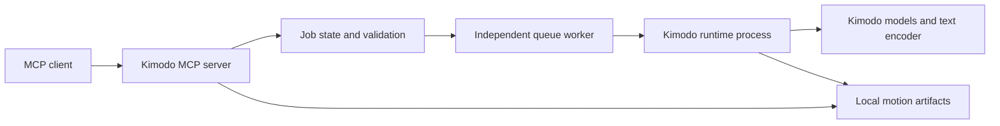

# Architecture

The MCP process provides a small, typed interface to animation work. A separate Python process executes Kimodo so model loading, native extensions, and inference logs do not share the protocol's standard output.

## Configuration boundary

The operator selects the Kimodo source checkout, runtime Python, and data directory through environment variables. Tool requests describe animation work; they do not select arbitrary executables, Python modules, or checkpoint configuration files.

The bridge depends on the MCP Python SDK (`mcp>=1.28,<2`). Kimodo and its GPU dependencies belong in the separately configured runtime. This keeps tool discovery and read-only operations usable while optional model dependencies are unavailable.

## Request lifecycle

A request is checked before starting expensive work: model selection, sample count, segment durations, finite numeric values, frame bounds, and constraint shapes must agree. The submission returns a job identifier. Clients inspect status and collect artifacts after completion rather than holding a single long protocol call open during a model download or generation.

SQLite stores job status and the request. A manifest records the exact model, seed, prompts, durations, effective settings, reviewed source revision, and output checksums. Status can be `queued`, `running`, `cancelling`, `completed`, `failed`, `cancelled`, or `interrupted`. An independently started queue worker survives client disconnection and runs the per-job supervisor, which applies timeouts and terminates inference on cancellation. Artifact retrieval requires successful completion, so a partial file cannot masquerade as a completed generation.

The default `KIMODO_WORKER_MODE=service` requires a live worker heartbeat before accepting generation. Start it with `scripts/start_worker.ps1` on Windows, or run the bridge Python with `-m kimodo_mcp.worker_service` independently using the same settings. Its exclusive lock allows only one queue consumer per data directory. This is a background process, not an installed operating-system service; restart it after reboot or configuration changes. Download permission is read from the worker environment.

The optional `child` mode launches a supervisor from the MCP client process. Windows may terminate that process tree when a client disconnects. Use the independent worker for generation that must outlive a client session; the child mode does not guarantee persistence.

## Artifact boundary

Motion data stays in the configured data directory. Protocol responses contain metadata and artifact references rather than an entire animation array. The worker validates array shapes and finite numeric values before publishing its manifest. Artifact paths must both appear in that manifest and resolve inside the job directory. Upstream example assets are useful integration fixtures, but they remain distinguishable from newly generated results.

## Concurrency and resource use

GPU work is serialized using a file lock in the common data directory. Multiple clients can start separate bridge instances and still share that lock and the SQLite job database. Using different data directories creates separate execution slots, so configure all clients with the same directory on a single GPU. Clients must not assume that submitting several jobs increases GPU throughput. Model and encoder loading often dominate first-run time and memory.

The default pending-job limit is 16. `KIMODO_JOB_TIMEOUT` defaults to 3600 seconds, with the same limit separately applied to queue waiting and worker execution. Model weights are offline by default; only the operator can enable downloads with `KIMODO_ALLOW_DOWNLOADS=1`.

## Transport

Stdio is the default for desktop assistants. Streamable HTTP is restricted to loopback for local sharing. Neither transport changes Kimodo's model capabilities. Remote hosting, authentication, quotas across untrusted users, and public file serving are outside this integration's scope.

## Upstream boundary

This package invokes Kimodo's public generation and export workflows rather than modifying the diffusion model. Upstream behavior is pinned in the review to commit `e1c219c99b4b94ba48be1fb6a1cbc64ecee4c954`. Updating the source checkout can alter models, prompt parsing, defaults, or file formats, so rerun compatibility checks before changing production inputs.
