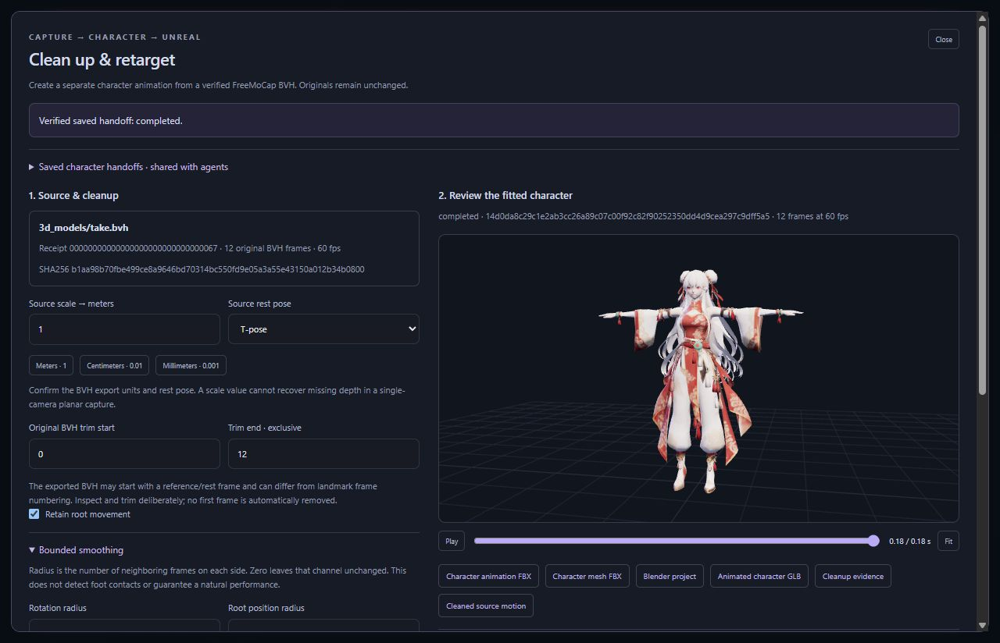

# FreeMoCap cleanup, character retargeting and Unreal delivery

This workflow converts a verified FreeMoCap **exported BVH** into an animation on the registered, checksum-matched 24-bone character. It does not infer bone rotations from landmark positions or retarget an arbitrary skeleton. The original capture and every previous attempt remain unchanged. Studio and MCP invoke the same preparation, execution and verification functions.

*The screenshot uses a deliberately synthetic 12-frame capture test and the registered character. It demonstrates the interface and exported animation, not the quality of a real reconstructed performance.*

## Prepare the source

1. Complete FreeMoCap MediaPipe processing and a separate BVH export. Keep the export receipt ID and exact artifact path. Processing alone is insufficient.
2. In **Capture workspace**, load that export receipt and choose **Clean up & retarget** beside the BVH. Agents call `inspect_freemocap_retarget_source` with `job_id` and `artifact_path`.
3. Confirm the BVH scale explicitly: meters use `1`, centimeters `0.01`, millimeters `0.001`. Select the actual exported T-pose or A-pose. A scale value cannot restore depth to a planar single-camera reconstruction.
4. Inspect the original BVH frame count and choose a trim of 2–2,400 frames. End indices are exclusive. Exported BVH frame numbering can differ from landmark numbering: the reviewed exporter can insert a reference/rest pose at its first frame. The bridge never discards that frame automatically.

The inspector verifies export and processing receipts, source fingerprints, integer timing and the reviewed bone hierarchy. It accepts integer frame rates from 1 to 120 FPS and preserves them. Fractional rates require an explicit external resampling step. The registered character is checked against its supported asset checksum before preparation and execution.

## Apply small, reproducible corrections

The `capture_retarget_request` schema exposes the full controls:

| Control | Behavior |
| --- | --- |
| `start_frame`, `end_frame` | Copy the exact selected original BVH rows into a new immutable preparation. |
| `source_scale_to_meters`, `source_rest_pose` | Required source interpretation, checked against source geometry during execution. |
| `root_motion` | Preserve planar root travel and heading when enabled; vertical body motion remains. |
| `rotation_smoothing_radius` | Zero disables filtering; 1–5 averages neighboring unit quaternions within the selected window. |
| `root_smoothing_radius` | Zero disables filtering; 1–5 averages root positions within the selected window. |
| `smoothing_start_frame`, `smoothing_end_frame` | Original BVH frame window inside the trim; omitted values use the trim bounds. |
| `blend_frames` | 0–30 frames of tapered blending at each smoothing-window edge. |
| `joint_corrections` | Up to 16 unique named character joints; local X/Y/Z offsets limited to ±45 degrees with their own original-frame windows and blends. |

Filtering uses a sign-invariant quaternion mean and tapered interpolation. Joint offsets apply in local current-pose X → Y → Z order. The target's bone lengths remain fixed, so non-root source translation channels are intentionally discarded. Toe bones inherit their foot's rotation. Independent fingers, facial expression, cloth and hair are outside this fitted profile.

Smoothing is an explicit numerical edit. It can alter foot placement and does not detect contacts, solve collisions, guarantee planted feet or establish realism. Review the character and `cleanup-report.json` before delivery. The report records maximum rotational/root changes and adjacent-frame motion before and after filtering.

## Run, inspect and resume

`prepare_freemocap_character` saves a preparation bound to source, processing/export receipts, character, options and trusted script hashes. It runs no editor. `execute_freemocap_character` is the separate connected-Blender action. The fixed script builds a separate scene, restores the previous active scene, exports outputs and verifies timing, hierarchy, finite motion, skin weights and bone lengths.

`get_freemocap_character` rechecks the preparation and completed report. `list_freemocap_character_handoffs` provides bounded shared history, explicitly labeled as unverified metadata until a handoff is opened. A recorded dispatch without completion is unresolved; inspect Blender and existing evidence before deliberately choosing another `attempt`. An automatic retry could duplicate editor work and is blocked.

Completed handoffs expose six verified artifacts through `get_freemocap_character_artifact` and Studio download links:

- `animation.fbx`: animation-only character skeleton.
- `character.fbx`: fitted character mesh and skeleton.
- `character.blend`: saved character scene and animation.
- `character-preview.glb`: self-contained animated browser preview.
- `cleaned-motion.npz`: fitted-character positions, rotations, source frame indices and preserved FPS.
- `cleanup-report.json`: exact edit settings and numerical changes.

The cleaned archive is a `registered-character24` representation. It is not a Kimodo SOMA job or a substitute for original landmark observations.

## Deliver to Unreal

After visual review, load the saved Unreal target and enter a **new animation asset name**. `prepare_freemocap_unreal` binds the completed animation FBX to an explicit `.uproject`, existing Skeleton, skeletal mesh and destination. It preserves the capture FPS. `execute_freemocap_unreal` uses the existing editor transport and checks the intended project and matching hierarchy. `get_freemocap_unreal` reads final import evidence or an unresolved-dispatch status.

This path imports animation onto an already compatible character rig. Initial skeletal-mesh import and unrelated-rig retargeting remain separate editor tasks. It does not overwrite an existing animation asset. A prepared script is not proof of an imported Unreal animation.

Read `get_workflow("capture-character")` for the ordered agent recipe. The original Kimodo text-generation workflow and its source-rig corrections remain separate and retain their own source identity.

## Validation evidence and limits

Unit and protocol tests exercise immutable preparation, strict windows, hierarchy/receipt binding, tamper rejection, cleanup math, six-artifact access, structured MCP results, HTTP parity, preserved FPS and uncertain Unreal dispatch recovery. Fresh headless Blender validation used the actual registered character and synthetic 12-frame motions at 24, 30 and 60 FPS, including T/A rest poses. All 24 bones survived FBX round trips, all evaluated frames were finite, no mesh vertices were unweighted, and maximum roundtrip position error stayed below 0.000001 meters.

These checks establish implementation and interchange behavior. Real footage reconstruction, artistic quality and acceptance in a live Unreal project were not validated by the synthetic fixtures.
