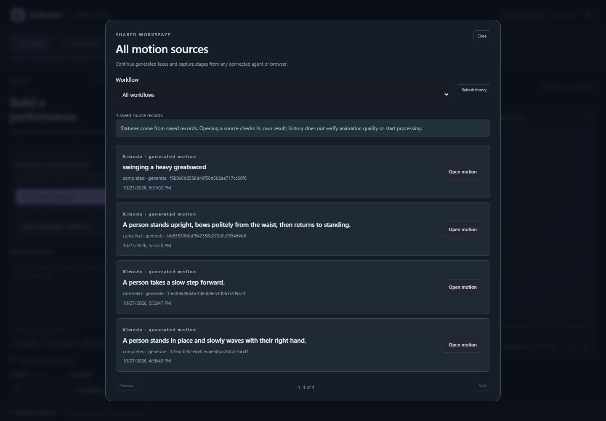
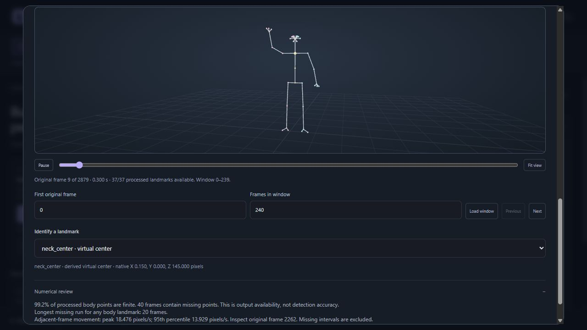

# Review and resume captured motion

Use the shared motion history to find work created by another browser or MCP client, then inspect it through the tools for that source type. Completed FreeMoCap process and export receipts support local landmark inspection, body diagnostics and verified file retrieval without a running capture service. These operations do not rerun tracking, repair motion, export a rig or open an editor.

The existing operator configuration, recording folders, source videos, calibration evidence and saved outputs must remain available. A stopped service is compatible with offline review; deleted or changed evidence is not.

## Find an existing take



Call `get_workflow("resume-motion")` for the ordered cross-source recipe. Start with:

```json
{
  "source_kind": "freemocap",
  "limit": 30,
  "offset": 0
}
```

Pass this object to `list_motion_sources`. The filter accepts `all`, `kimodo`, `easymocap` or `freemocap`; the limit is 1–100. Follow `next_offset` to read another page. The bounded index reports `partial` and warnings when records are malformed, redirected, oversized or exceed its scan budget.

Each result retains `source_kind`, `source_id`, recorded status and source-specific status/review arguments. This is metadata history: `verification="not_checked"` and `metadata_only=true` mean no fresh output verification has occurred. A historical `completed` label is a pointer to inspect, not permission to treat an animation as correct.

| Source kind | Check the selected source | Inspect motion | Obtain files |
| --- | --- | --- | --- |
| `kimodo` | `get_job` | `inspect_motion_frames`, with the desired sample and optional saved variant | `list_job_outputs` or `get_artifact` |
| `easymocap` | `get_video_mocap_job` | `inspect_video_mocap_frames` | `get_video_mocap_artifact` |
| `freemocap` | `get_freemocap_job` | `inspect_freemocap_frames` for verified completed processing/export | `get_freemocap_artifact` |

Keep the source kind alongside every ID. The three namespaces and skeleton representations are not interchangeable. A FreeMoCap import, calibration or synchronization receipt is useful history, but is not a processed body trajectory. Pending or uncertain stage outcomes still need their actual service evidence; offline history never promotes them to success or retries them.

## Inspect saved FreeMoCap frames



*This screenshot uses a synthetic planar test recording to demonstrate the actual review interface. It does not demonstrate real tracking or retargeting accuracy.*

`inspect_freemocap_frames` accepts a completed process or export `job_id`, `frame_indices` and an `aspect`:

```json
{
  "job_id": "<32-character process or export receipt ID>",
  "frame_indices": [0, 30, 59],
  "aspect": "body"
}
```

Select up to 16 unique, zero-based original recording frames. The response preserves the requested order. An omitted or empty list selects frame zero. Indices must fit the actual saved array and cannot exceed 143999. The tool does not silently downsample or compress a timeline with missing points.

The aspects are `body`, `left_hand`, `right_hand` and `face`. The response includes names, the profile and its sources, coordinates, timing availability, source checksum, the underlying processing receipt ID and `frames_inspected`. Each inspected frame contains `positions_native` and `valid_mask` in the same landmark order. If any coordinate of a point is missing, the whole triplet is `null` and its mask is false. Missing points are never replaced by the origin. Infinite or excessive coordinates are rejected.

| Saved profile | Body | Each hand | Face |
| --- | --- | --- | --- |
| MediaPipe | 33 detector-derived points plus 4 virtual centers | 21 | 136 saved output indices |
| RTMPose | 23 detector-derived points plus 4 virtual centers | 21 | 68 saved output indices |

The appended virtual body points are `head_center`, `neck_center`, `trunk_center` and `hips_center`. `tracked_mask=false` identifies them. A true value means the profile point originates from a detector layout; it does not prove that a particular output frame was directly observed. Upstream interpolation, filtering, ground alignment and hand-to-wrist adjustment can affect the saved trajectories.

Hand names are local to the requested side. For example, the saved MediaPipe hand starts with `wrist`, while the saved RTMPose hand starts with `hand_root`. Face names such as `face_0001` identify saved array columns. They are not a claim that the column is MediaPipe's full-mesh landmark 1 or an anatomical facial feature. The saved face profile has no verified topology; it supplies no facial rig, blendshapes or expression controls.

## Read coordinates and timing before interpreting numbers

All returned positions retain the saved numerical scale. The review does not convert capture data to Kimodo coordinates.

| `coordinates.units` | Meaning |
| --- | --- |
| `pixels` | One-camera planar output. Native Y is zero, Z points up, and depth and physical scale are unavailable. |
| `millimeters` | The selected multi-camera calibration is linked by path and checksum to an owned, verified calibration receipt with measured board geometry. This identifies the scale convention; it does not establish calibration accuracy. |
| `calibration_units` | Multi-camera geometry exists, but the adapter cannot establish its physical translation scale from the saved evidence. A manually supplied TOML is not silently assumed to be measured in millimeters. |

`floor_verified` remains false. Upstream may align a reconstruction to its estimated feet; that does not establish correct ground contacts. Landmark files contain no fitted local joint rotations or contact labels, so native SOMA pose correction and character handoff are unavailable for these sources.

New processing receipts preserve submitted video frame counts and nominal FPS. The saved array must agree with those counts. `time_seconds` is the original frame index divided by the persisted FPS, relative to the recording start; it is not a measured camera exposure timestamp. Older receipts without that timing return `fps=null` and `time_seconds=null`. The review preserves frame inspection instead of inventing a playback rate.

## Use diagnostics to choose review frames

Call `analyze_freemocap_quality` with the same `job_id`. It reads the entire saved **body** trajectory and reports:

- Finite-position fractions for all body points and each individual point.
- The longest consecutive missing run for each point and the number of frames containing missing points.
- The maximum and 95th percentile of adjacent-frame movement, its unit, eligible interval count and the original frame ending the largest movement interval.
- Suggested `review_frames`, combining representative frames, a frame with the most missing points and the largest movement interval's ending frame.

These totals include the four virtual body centers. Use the accompanying names and `tracked_mask` to distinguish detector-derived points from computed centers. The report measures processed output availability, not raw tracking coverage or confidence.

Movement is Euclidean displacement between consecutive original frames. Both endpoints must be finite; a gap is never bridged. When FPS is available, displacement is multiplied by that nominal rate and reported in native units per second. Without FPS it remains displacement per frame. A single-frame or wholly missing result reports movement as unavailable. Frame windows and masks remain available for inspection.

There is no overall quality score, automatic winner, contact estimate or repair operation. A large movement may be intentional; a smooth trajectory may still be inaccurate. Follow `review_frames` with `inspect_freemocap_frames`, inspect neighboring frames and compare with the source footage before deciding what to change. Hand and face frame inspection is available through MCP, but this diagnostic currently summarizes the body only.

## Review in the Studio

Open **Create → Open capture workspace**. Shared capture history comes from the same local receipts used by agents. Select a verified completed processing or export receipt to open **Review captured body landmarks** and its numerical review. This viewer is read-only and displays body points, their connections and virtual centers. It does not display an animated character mesh or expose direct landmark corrections.

Use **First original frame** and **Frames in window** to load a contiguous part of a long recording. The default window is 240 frames; a request can load up to 2400. **Previous**, **Next** and the suggested frame buttons retain original frame numbering. Playback stays within the loaded window. If the receipt has no FPS, playback is disabled and frame scrubbing remains available.

Click a point or choose its name to inspect its original native coordinates and availability. The display rotates native Z-up into the viewer's Y-up convention without changing scale; the coordinate readout remains native. Invalid points and their connecting edges disappear for that frame. A virtual center is labeled as derived. Hands and face are currently available through the MCP frame-inspection tool, not this body viewer.

The read-only HTTP endpoints are:

```text
GET /api/freemocap/{job_id}/preview?start_frame=0&count=240
GET /api/freemocap/{job_id}/files/{receipt-relative-path}
```

The preview accepts `start_frame` and `count` once each; unknown or repeated query parameters are rejected. It returns contiguous original frames without downsampling. Both routes inherit Studio's local host/origin checks. Download paths must match a verified completed receipt entry; they are not arbitrary file access.

## Retrieve a verified output

Read `outputs` from the verified process or export receipt, then pass an exact listed path to `get_freemocap_artifact`:

```json
{
  "job_id": "<32-character process or export receipt ID>",
  "path": "output_data/mediapipe_body_3d_xyz.npy"
}
```

The response provides the verified local path, byte count, checksum and source kind. The example name is valid only if that exact file appears in the selected receipt. FBX, BVH or `.blend` retrieval likewise requires the actual export receipt and its recorded paths. Retrieving a file does not start an export or open Blender.

The loader verifies owned recording identity, relevant receipt metadata, sources and outputs. Export-based landmark review additionally binds the matching processing receipt and the exact selected array. Float32/float64 NPY files must match the reviewed aspect layout, frame budget and exact header/data length; pickle/object arrays are refused. Read-only memory mappings are closed on successful and failed calls, including invalid frame selections, so failed inspection does not keep Windows files locked.

## An agent instruction for continuing work

> Resume existing motion without starting generation, tracking or an editor. Read `get_workflow("resume-motion")`, then use `list_motion_sources` with the appropriate source filter and pagination. Keep each source kind with its ID. For the selected FreeMoCap take, inspect its receipt and require completed processing or export with verified terminal evidence. Run `analyze_freemocap_quality`, explain its native units and timing basis, and inspect the reported problem frames plus their neighbors. Use `aspect="left_hand"`, `"right_hand"` or `"face"` when those details matter. Treat missing points as missing and virtual centers as derived. Resolve only output paths actually listed in the verified receipt. Report what the numerical checks establish, what still requires footage or retargeting review, and any unresolved receipt; do not automatically retry or export.

For new work, follow the separate [FreeMoCap stage guide](freemocap.md) or [EasyMocap fitting guide](easymocap.md). Capture review does not add a FreeMoCap-to-SOMA converter, cross-source skeleton comparison, automatic character fitting, finger/face retargeting or Unreal import compatibility.

## Reviewed profiles and validation

The format facts come from SkellyForge revision `b96272b1ef06546c1a55d404a5f4a92f1fad1b0f`, pinned by the reviewed FreeMoCap checkout: [MediaPipe profile](https://github.com/freemocap/skellyforge/blob/b96272b1ef06546c1a55d404a5f4a92f1fad1b0f/skellyforge/skellymodels/tracker_info/mediapipe_model_info.yaml), [RTMPose profile](https://github.com/freemocap/skellyforge/blob/b96272b1ef06546c1a55d404a5f4a92f1fad1b0f/skellyforge/skellymodels/tracker_info/rtmpose_model_info.yaml), [virtual-point append order](https://github.com/freemocap/skellyforge/blob/b96272b1ef06546c1a55d404a5f4a92f1fad1b0f/skellyforge/skellymodels/models/trajectory.py) and [saved-array naming](https://github.com/freemocap/skellyforge/blob/b96272b1ef06546c1a55d404a5f4a92f1fad1b0f/skellyforge/skellymodels/managers/actor.py). The bridge contains original profile data and display-graph code; it does not vendor these implementations.

The actual installed dependency revisions are not attested by an old processing receipt. The response explicitly reports `profile_binding.runtime_dependency_revision_verified=false`: binding uses the submitted detector and exact saved-array layout against the reviewed profile. It does not trust `tracker_schema.json`, which the [pinned posthoc task](https://github.com/freemocap/freemocap/blob/700c8614d11d886dacfea8e52333d3c0b942ef52/freemocap/core/tasks/mocap/posthoc_mocap_task.py) can label as RTMPose after MediaPipe processing. Unrecognized layouts are rejected.

Validation uses synthetic landmark arrays, missing-point cases, corrupted files, receipt/source changes, offline service failures and memory-map cleanup tests. These checks establish parsing, masking, provenance and numerical behavior. They do not demonstrate real-footage calibration, reconstruction accuracy, detailed facial animation or game-engine acceptance. No new inference, tracking or editor work is required to run these review checks.
