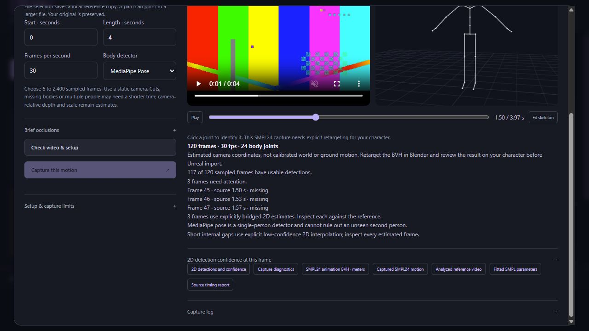

# Video capture with EasyMocap

The video workflow fits a single SMPL body to a selected interval of a local video. It produces a review video, a 24-joint motion archive, a BVH animation, fitted parameters and detection diagnostics. These are separate video-capture jobs, not Kimodo generation jobs. Starting a capture is explicit; checking readiness does not fit a body or download weights.

The adapter targets EasyMocap revision `e6006fd3814d5f8ad45a7ce965beb9bcc90767f2`. See the [source audit](mocap-source-audit.md) for the implemented entry points and known upstream pitfalls.

In the Studio, open **Create → From video · EasyMocap**. Choose a file or local path, select the trim and detector, check setup, then explicitly start. The review pairs the analyzed video and skeleton, supports shared playback/scrubbing and displays detection confidence and estimated-frame labels. Setup, capture and review use the same tools listed below.



This screenshot validates the interface with synthetic test data. It does not demonstrate reconstructed real footage.

## What ordinary footage can support

Use a static camera, one fully visible person, a clear silhouette and limited occlusion. A fitted body is an estimate: ordinary monocular footage does not uniquely determine depth, physical scale, hidden limbs or world trajectory. Fast motion, loose clothing, camera movement and cropped limbs can produce plausible but incorrect poses. A numerically valid skeleton is not evidence of capture accuracy.

The camera uses an assumed focal length of `1.2 * min(image height, image width)`, centered principal point, identity extrinsics and zero distortion. The resulting coordinates are camera-relative, with estimated meter scale and Y-up. No floor alignment, contact inference, foot locking, finger capture or face capture is performed. The MediaPipe detector finds one person and cannot prove that no other person is present outside its chosen detection.

This release's validation includes synthetic SMPL forward-kinematics comparisons, independent BVH parsing and mocked pipeline/lifecycle tests. It does not establish that a licensed runtime is installed on a particular machine or that real footage has been reconstructed successfully.

## Operator setup

Keep the MCP/Studio environment separate from EasyMocap's legacy numerical environment. The adapter itself requires Python 3.11 or newer. Its external stage and numerical conversion modules are compatible with Python 3.9 syntax; that does not guarantee that every combination of Torch, NumPy, MediaPipe and licensed model files works together.

1. Check out the exact reviewed EasyMocap revision in an operator-controlled directory. Tracked changes cause readiness to fail.
2. Create a separate Python environment with compatible Torch/Torchvision and the dependencies needed by the reviewed pipeline. Consult the pinned upstream requirements; they include legacy pins and should not be installed into the Studio environment. Readiness checks dependencies and assets but is not a full fitting test.
3. Install FFmpeg and FFprobe. Configure their executable paths explicitly.
4. Obtain the body model and model weights from their authorized sources, following their individual license terms. Place the files at the exact paths below.
5. Create `<KIMODO_DATA_DIR>/video-mocap/runtime.json` with absolute paths:

```json
{
  "python": "D:/MotionRuntime/easymocap-env/Scripts/python.exe",
  "repo_path": "D:/MotionRuntime/EasyMocap",
  "ffmpeg": "D:/Tools/ffmpeg/bin/ffmpeg.exe",
  "ffprobe": "D:/Tools/ffmpeg/bin/ffprobe.exe",
  "device": "cpu"
}
```

These are example installation paths, not bundled files. `device` accepts `cpu` or `cuda`; CUDA selection requires a compatible available device. Runtime paths and model installation are operator settings, not executable arguments supplied by an agent.

Required paths relative to the EasyMocap checkout:

| Asset | Path |
| --- | --- |
| Neutral SMPL model | `data/bodymodels/SMPL_python_v.1.1.0/smpl/models/basicmodel_neutral_lbs_10_207_0_v1.1.0.pkl` |
| BODY25 regressor | `data/smplx/J_regressor_body25.npy` |
| SPIN checkpoint | `data/models/spin_checkpoint.pt` |
| SPIN mean parameters | `data/models/smpl_mean_params.npz` |
| YOLO checkpoint, for `yolo-hrnet` | `data/models/yolov4.weights` |
| HRNet checkpoint, for `yolo-hrnet` | `data/models/pose_hrnet_w48_384x288.pth` |

SPIN also requires the Torchvision ResNet50 ImageNet V1 checkpoint in the configured runtime's Torch hub checkpoint cache. For `mp-pose`, the MediaPipe installation must expose the legacy `solutions.pose` API and contain `modules/pose_landmark/pose_landmark_heavy.tflite` and `modules/pose_detection/pose_detection.tflite`. The readiness response identifies missing files. External Python stages block network connections; they do not silently fetch missing models.

The pinned [EasyMocap license](https://github.com/zju3dv/EasyMocap/blob/e6006fd3814d5f8ad45a7ce965beb9bcc90767f2/LICENSE) is Project Registration License v1.0. It permits research, educational, evaluation and personal use without registration and requires registration before organizational project use. Body models and weights have separate terms. The adapter does not distribute those assets or complete registration for the operator.

## Agent and Studio workflow

Discover the `video-mocap` recipe with `get_workflow` and the `video_mocap_request` schema with `get_input_schema`. Start by calling `plan_video_mocap` with a request such as:

```json
{
  "video_path": "D:/MotionReferences/walk.mp4",
  "start_seconds": 0,
  "duration_seconds": 4,
  "fps": 30,
  "max_frames": 2400,
  "detector": "mp-pose",
  "max_gap_frames": 0
}
```

`video_path` names a local file, not a URL or encoded video data. The file must be nonempty and no larger than 2 GiB; source dimensions must be between 16 and 7680 pixels per axis. The selected interval must fit within the video's reported duration. `start_seconds` is bounded to 0–86400, `duration_seconds` to more than zero and at most 80, and `fps` to 1–60. The sample count is `floor(duration_seconds * fps + 1e-8)` and must be between 6 and `max_frames`, at most 2400. A six-frame minimum avoids an empty temporal-loss calculation in the pinned fitting configuration. Detector choices are `mp-pose` and `yolo-hrnet`.

| Tool | Purpose |
| --- | --- |
| `plan_video_mocap` | Validate selection, fingerprint source/assets, and report readiness and limits. No capture is submitted. |
| `start_video_mocap` | Explicitly submit the same validated request to a separate capture process. |
| `get_video_mocap_job` | Read stage, status, diagnostics and verified completion output. |
| `list_video_mocap_jobs` | Find recent capture jobs independently of Kimodo generation jobs. |
| `get_video_mocap_log` | Read a bounded, redacted tail of the job log. |
| `cancel_video_mocap_job` | Request cancellation; wait for terminal status before starting another capture. |
| `inspect_video_mocap_frames(job_id, frame_indices=[])` | Inspect up to 16 unique, zero-based frames within the captured trim; empty selects frame zero. Returns all 24 joints, sampled source times and 2D confidences. |
| `get_video_mocap_artifact(job_id, name)` | Resolve one allowlisted, checksum-verified completed artifact with its local path, size and checksum. |

Use tool discovery for exact arguments. A successful readiness result is permission to proceed technically, not evidence that fitting has run. Check completion status and diagnostics before describing output as available. Do not send a video job ID to the normal SOMA correction, pose-anchor or character-handoff tools.

Studio can copy a selected browser file into its local managed reference directory through token-protected `POST /api/video-mocap/reference?extension=mp4`. This route streams at most 512 MiB and accepts `mp4`, `mov`, `mkv`, `webm`, `avi` or `m4v`; it does not start capture. Larger supported local videos can be selected by local path. Verified review and download routes are `/api/video-mocap/{job_id}/preview` and `/api/video-mocap/{job_id}/files/{name}`. They inherit the Studio localhost host/origin protections.

## Stages and failure behavior

The fixed pipeline extracts JPEG samples with FFmpeg, creates `reference.mp4` from those exact images, detects BODY25 landmarks, validates every frame, writes the assumed camera, runs the reviewed monocular fitting configuration, normalizes SMPL motion and verifies outputs. Extracted images preserve aspect ratio and fit inside 1280 × 1280 pixels.

By default, missing, ambiguous, nonfinite, weak or degenerate detections stop fitting. Each observed frame needs person ID zero, at least five joints above confidence 0.05 and a usable confident-point bounding box. This prevents upstream initialization from silently copying an earlier pose. Detection confidence describes image landmarks, not certainty in the reconstructed 3D body.

For brief occlusions, explicitly set `max_gap_frames` to 1–15, or use **Brief occlusions** in the Studio. Short internal runs of missing/weak observations may use linear 2D landmark interpolation between valid detected endpoints. Estimated confidence is capped at 0.25. Original detector status and keypoints remain in `detections.json`; separate `fitted_keypoints`, endpoint indices, interpolation fractions and `estimated_frames` identify the estimates. The Studio labels those frames and MCP frame inspection returns their indices. This does not recover hidden motion or estimate 3D confidence. No endpoint extrapolation, identity mismatch, ambiguous-person gap, invalid/degenerate input, collapsed intermediate body or gross endpoint displacement is bridged. Longer or unresolved gaps still stop fitting; the source timeline is never compressed.

After planning, pass `expected_source_sha256=plan.source.sha256` to `start_video_mocap` to bind submission to the checked video. The Studio does this automatically and consumes its ready state before dispatch, so a lost response does not invite a blind duplicate submission.

Only one video job is dispatched at a time. It has its own execution lock and does not use the Kimodo generation worker. Cancellation is cooperative between stages and monitored during child processes; it is not an automatic retry. Process identity includes creation identity so a reused PID is not treated as the original worker. If the supervisor stops while its recorded child still runs, a new dispatch is blocked until that child stops. An interrupted or failed job remains available for diagnosis; explicitly start a new job to retry. The adapter cannot guarantee recovery from an operating-system or power failure.

## Outputs, time and provenance

Managed files live under `<KIMODO_DATA_DIR>/video-mocap/jobs/<job_id>/`. Completion publishes a manifest binding the request, source checksum, reviewed revision, timing and artifact checksums. Source video and installed assets are checked before processing and again before successful publication. Artifact retrieval verifies the manifest and file checksums; unfinished files are not published as completed outputs.

| Artifact | Contents |
| --- | --- |
| `reference.mp4` | Constant-rate playback of the exact analyzed images. |
| `motion.npz` | Safe numeric/string arrays: 24-joint positions, local/global rotations, root positions, fitted-shape rest joints, hierarchy, frame rate, coordinate transform, sampled times and 2D landmarks. |
| `motion.bvh` | The same animated SMPL24 hierarchy with meter translations and intrinsic XYZ rotation channels. |
| `smpl-parameters.json` | Fitted per-frame body parameters and source identity. |
| `detections.json` | Per-frame image landmarks, person identity and detection status. |
| `timing.json` | Sample times, selected range and the constant-rate resampling declaration. |
| `diagnostics.json` | Coverage failures or successful frame coverage, FK comparison error and explicit contact/scale limits. |

Frame zero corresponds to the selected start time. `source_time_seconds` is `start_seconds + frame_index / fps`: these are requested constant-rate sample times, not original camera exposure timestamps. FFmpeg may duplicate or drop input frames. Review against `reference.mp4`, not an assumption of one output pose per original encoded frame. A clip of F samples has F/fps playback duration and (F−1)/fps between its first and last pose.

Normalized world coordinates apply `diag(1,-1,-1)` to the source camera coordinates: X points right, Y up, and the source camera's forward depth becomes negative Z. This is a proper rotation, not a reflection. The first joint is the pelvis; root translation includes the shaped pelvis offset under global rotation. `rest_joints` remain in the body's model-local coordinates for skeletal offsets; they are not camera-world positions.

## Blender and game-engine use

Download or resolve the verified `motion.bvh`, then import it as a BVH into a separate Blender scene. Use meter scale and the documented Y-up coordinate convention, inspect the root trajectory and compare several poses with the reference video. The BVH has no mesh, skin, clothing, contacts or retarget mapping. Importer axis controls differ, so verify orientation rather than assuming an importer preset proves it.

Existing automatic Kimodo/character handoffs expect their managed SOMA sources and are not a video-to-character retargeter. Mapping this SMPL24 animation to a character or Unreal skeleton requires an explicit retarget setup and validation of rest pose, scale, hierarchy and root motion. A BVH export alone does not establish game-engine acceptance or production animation quality.
