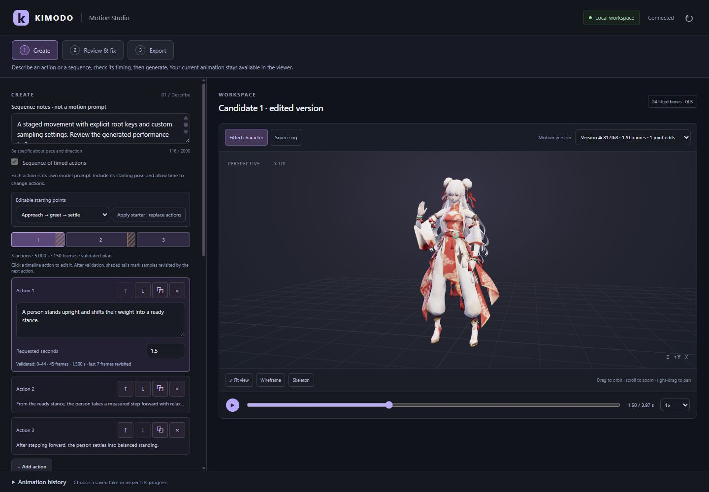
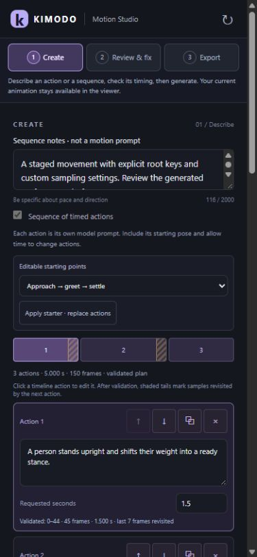
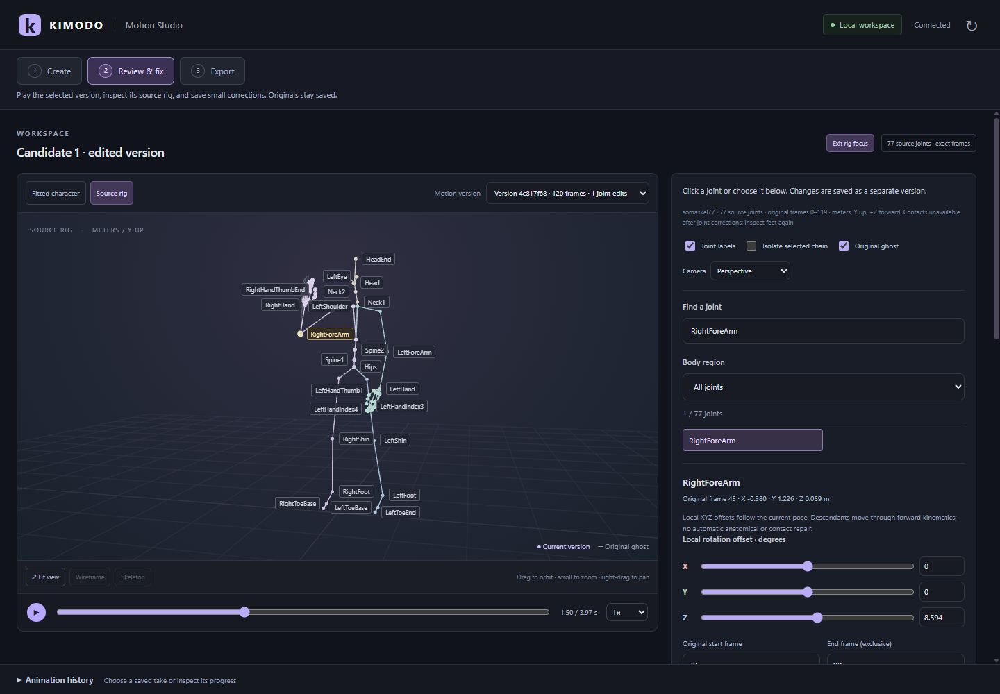
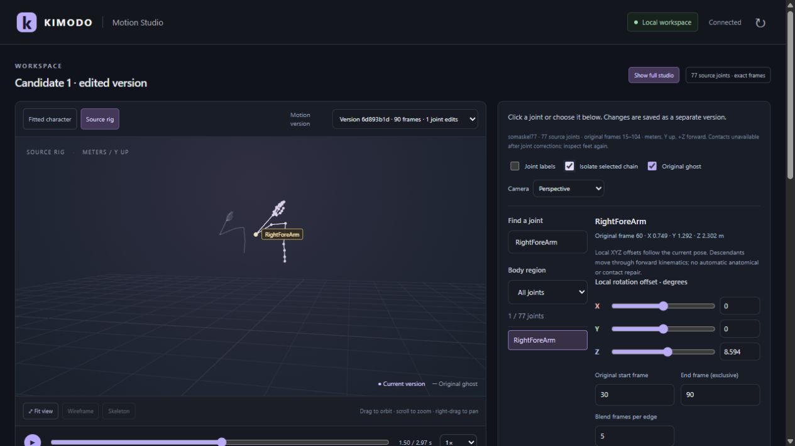
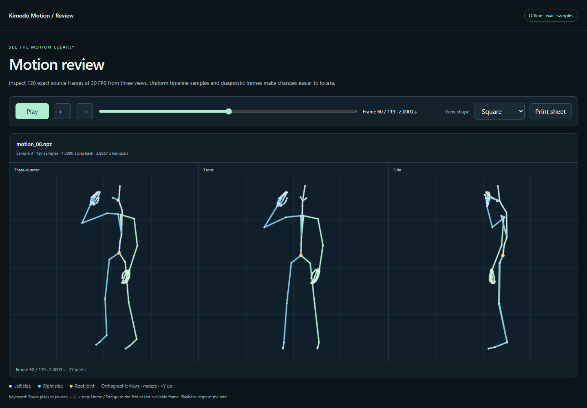
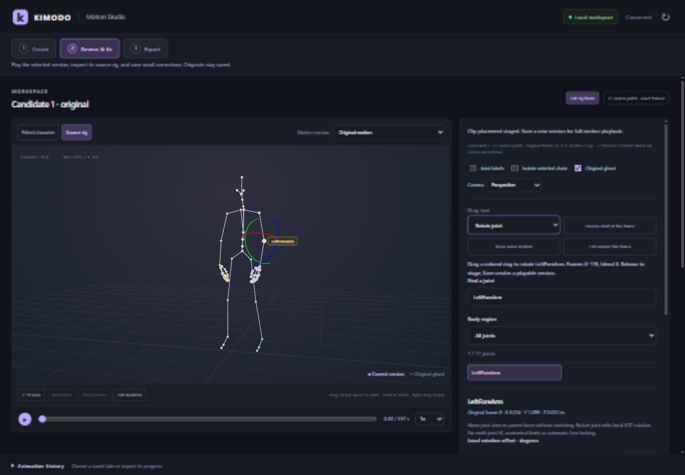

# Local animation studio

The studio is a local browser interface to the same planning, jobs, diagnostics, and editor operations exposed by Kimodo MCP. It lets you move from a description to reviewed animation without manually copying requests between tools.

MCP clients can use `get_capabilities`, `get_workspace_state`, and `get_workflow` to discover the same workspace and complete workflows. Saved animation plans, `build_character_preview`, saved Unreal targets, and verified output listing are shared operations, available directly through MCP as well as the studio. The browser owns interactive camera and playback controls. See [the agent workflow guide](agent-workflows.md) for discovery, selected-frame inspection, reusable constraints, and exact tool contracts.

Opening the interface does not download model weights or start inference. A connected studio, an available worker, an installed runtime, authorized models, and sufficient memory are separate readiness conditions.



The screenshots distinguish authoring a sequence from viewing a previously completed animation. The displayed model remains the selected saved candidate until a new job and preview finish. The demonstration character is separately supplied; source meshes, textures, checkpoints, credentials and generated motion files are not distributed in this repository.

## Choose an installation route

### Full Windows setup

Use PowerShell 7+, Git, `uv`, CMake, a working C++ compiler, and Node.js 22.12+. From the repository root:

```powershell
.\scripts\setup_runtime.ps1 -DataDirectory "D:\KimodoData"
.\scripts\start_studio.ps1 -DataDirectory "D:\KimodoData" -UpstreamDirectory "D:\KimodoData\upstream-kimodo" -StartWorker -OpenBrowser
```

The first script creates the bridge and inference environments. The second expects those environments at `mcp-env\Scripts\python.exe` and `runtime\Scripts\python.exe` under the data directory. Installing only a repository `.venv` does not satisfy this launcher's layout.

For first-run model access, follow the [README's authentication/download steps](../README.md#getting-started-on-windows). The studio launcher starts an offline worker when requested. It does not grant gated-model access, configure credentials, or change an already running worker's download permission.

| Launcher option | Behavior |
| --- | --- |
| `-DataDirectory` | Required external job/environment directory. |
| `-UpstreamDirectory` | Reviewed Kimodo checkout; needed to start a worker when not already configured. |
| `-StartWorker` | Starts or reuses the independent worker through the worker helper. |
| `-Build` | Installs locked frontend dependencies and rebuilds the UI even when a build exists. |
| `-Port` | Local HTTP port, default `8768`. |
| `-OpenBrowser` | Opens the studio after startup or when reusing an existing instance. |

The launcher reuses an existing studio only if it serves the same data directory. It launches no editor, closes no other application, and installs no operating-system service. Its process ID and stdout/stderr logs are stored beneath the selected data directory.

### Manual source installation

After installing the Python bridge, build the interface:

```powershell
cd web
npm ci
npm run build
cd ..
```

Set the same environment used by the worker and MCP client, then start the studio with the bridge Python:

```powershell
$env:KIMODO_DATA_DIR = "D:\KimodoData"
$env:KIMODO_REPO = "D:\KimodoData\upstream-kimodo"
$env:KIMODO_PYTHON = "D:\KimodoData\runtime\Scripts\python.exe"
$env:TEXT_ENCODER_DEVICE = "cpu"
$env:HF_HOME = "D:\KimodoData\cache\huggingface"

.\.venv\Scripts\python.exe -m kimodo_mcp.studio --web-directory web/dist
```

Open **[http://127.0.0.1:8768](http://127.0.0.1:8768)**. Use `--port 8769` to change ports. On macOS/Linux, substitute the appropriate environment paths and `.venv/bin/python`.

Run the independent worker in another terminal with the same configuration:

```powershell
.\.venv\Scripts\python.exe -m kimodo_mcp.worker_service
```

Keep that process running. Closing the studio tab or an MCP client does not stop it. Restart after reboot or relevant configuration changes.

### Packaged and development builds

The web build writes both `web/dist` and the generated `src/kimodo_mcp/studio_web` package directory. Build the frontend before building a Python wheel. An installed wheel can serve its bundled UI; a source checkout can use `web/dist`. `--web-directory` explicitly selects a build and avoids ambiguity.

Browser code and Three.js are bundled locally with complete renderer and build-runtime notices, including Vite, Rolldown, and their preserved third-party attributions. The running interface needs no CDN. Node.js is needed to build the UI, not to serve a completed packaged build.

The frontend source lives under `web/src`, with locked dependencies and focused tests. `npm run dev` starts Vite on loopback; its development API proxy targets port 8768. Production validation should use the actual studio server because it also applies the browser resource and request policies.

## Move through three focused screens

The workflow buttons stay available above the workspace. Start in **Create**, use **Review & fix** for an existing take, and use **Export** when its selected version is ready to leave the studio.

| Screen | Visible work | What changing screens does not do |
| --- | --- | --- |
| Create | Single-action form or sequence composer, saved-plan library, planning controls and the existing 3D viewer. | It does not start inference or replace the viewed motion with the new text. |
| Review & fix | Viewer, candidate/version selection, source-rig controls, diagnostics, comparisons and verified downloads. | It does not apply staged corrections or build a character export automatically. |
| Export | Viewer, candidate/version selection, motion conversion, Blender/Unreal actions and verified downloads. | It does not execute an editor or write an animation asset merely by opening the screen. |

Changing screens preserves the current authoring draft, loaded saved plan, selected candidate/version, staged joint corrections and playback position. Selecting a different animation or version is a separate action with its own source checks. The main panel returns to its top when you switch screens; that scrolling does not seek the animation. Left/Right arrows move between workflow buttons, and Home/End select the first/last screen when a button has keyboard focus.

**Animation history** is a collapsible strip available in every screen. Open it to select a saved take, inspect progress or view a job log. Selecting an animation opens Review & fix; choosing its **Revise** action opens Create. Selecting the already active candidate does not discard its selected correction version. Candidate changes made inside Export remain in Export.

Success and error messages appear in a measured status area under the workflow navigation. They wrap or scroll within that area and can be dismissed; they do not float over playback or action buttons. On desktop, the creation and viewing panels scroll independently below the header. Narrow windows use a stacked document with persistent navigation. The history strip remains collapsible in both layouts.

<details>
<summary>View the narrow-screen sequence composer</summary>



The responsive interface remains a local desktop workflow. It does not expose the server to a phone or external network.

</details>

## Describe and plan

Choose **Create** to describe a complete physical action. Include pace, direction, and relevant starting conditions:

> A person stands in place and slowly waves with the right hand.

For one action, select 0.2–10 seconds, one to four candidates, and the generation effort. The presets fill the description; they do not secretly add constraints.

| Effort | Steps | Intended use |
| --- | ---: | --- |
| Draft | 20 | Explore an action with less sampling work. |
| Balanced | 50 | Default sampling effort. |
| Detailed | 80 | Try additional sampling effort on an idea. |

These are compute presets, not guaranteed quality levels. A low-step preset still loads the text encoder.

**Preview the plan** shows exact frame count, seed, sampling steps, candidate count, and notes. Expand the plan details for transition and constraint-density guidance. No inference begins. When a new draft's seed is blank, the studio chooses a fresh integer and shows it after planning. Generating from that unchanged form retains the displayed seed. Direct MCP briefs use seed zero by default.

The plan is a timing and settings preview. It does not animate the new text in the 3D viewport; that viewport continues showing the selected saved animation. Editing the draft invalidates the old validation until you preview again. Responses from an earlier asynchronous check do not replace a newer draft.

Planning preserves the text as written. Kimodo interprets the action during generation; the bridge itself does not contain a separate natural-language parser that invents choreography, discovers a new character rig, or turns “make it better” into precise edits.

### Timed sequences

Enable **Sequence of timed actions** to author two to eight beats. Each action card contains a complete description and a requested duration of 0.2–10 seconds. **Sequence notes · not a motion prompt** records your authoring context; those notes are not silently prepended to the action prompts.

**Undo actions** and **Redo actions** restore text, timing, ordering and deleted cards, with up to 50 history states. Typing in one field is grouped until focus changes; structural edits create separate history entries. Ctrl/Cmd+Z undoes inside the composer; Ctrl/Cmd+Shift+Z or Ctrl/Cmd+Y redoes. Loading a plan or applying a starter begins a new action-editing session. Preview, save and generation open the first invalid collapsed action and focus its required field.

1. Start with your own actions or select an editable starting point: **Approach → greet → settle**, **Crouch → jump → land**, or **Turn → walk → stop**. **Apply starter · replace actions** replaces the current cards, so use it deliberately.
2. Click a card summary or its numbered timeline segment to edit that action. Keep its starting pose, pace, direction and any persistent object clear.
3. Use the up/down controls to reorder a card, duplicate it to create a related action, or remove it. **+ Add action** inserts a new blank card. These controls preserve each remaining card's text and duration.
4. Enter requested seconds. The timeline immediately shows estimated frame allocations and total duration. Preview the plan to obtain authoritative backend timing and advisories.

For example:

| Beat | Example | Duration |
| --- | --- | ---: |
| 1 | A person walks forward at a relaxed pace. | 3 seconds |
| 2 | A person slows down and comes to a stop. | 2 seconds |
| 3 | A person stands in place and waves with the right hand. | 3 seconds |

At 30 FPS the example has `[90, 60, 90]` frames. The action cards display inclusive visible sample ranges `0–89`, `90–149` and `150–239`; the API expresses the same ranges with exclusive ends `[0,90)`, `[90,150)` and `[150,240)`. Each duration is quantized separately using `int(seconds × 30)`. A displayed rounded duration is not a substitute for the validated frame allocation. The single-action duration field is disabled in sequence mode.

After validation, shaded tails identify samples in an earlier action that the next action revisits. With the default five-frame transition, the second action generates history for frames `85–89` before its own `90–149` allocation; the third revisits `145–149`. Each requested action keeps its frame count. Transition history does not predict when the movement will visually settle or guarantee a seamless change of action. See [saved-plan timing](saved-animation-plans.md#read-the-timeline-precisely) for the upstream behavior.

### Save and reuse the complete plan

Open **Reusable plans**, enter a meaningful **Plan title** and choose **Validate & save version**. The studio validates the draft and saves the exact returned request. No generation begins. The library is shared with MCP clients using the same data directory.

**Refresh library** loads a page of up to 20 saved summaries. Use **Previous page** and **Next page**, select a version and choose **Load selected plan**. Invalid records are counted and excluded, rather than loaded silently. Regular job polling does not repeatedly rescan the full plan library.

Loading restores the full request, including settings the simple form does not expose: model, custom sampling steps, both guidance weights, transition length, first heading, root margin, postprocessing, formats, BVH convention and complete constraint arrays. The loaded-request note shows the actual steps and constraint count. A displayed detail preset is only a label until you deliberately choose a different preset; untouched custom steps remain preserved.

Edit only what you intend to change, preview, and save a new version. The original remains available and the child retains its parent-plan identity. Merely reloading an unchanged version does not create another saved record. Changing a title or sequence notes changes authoring metadata without silently changing model prompts. Clearing a previously fixed seed requires a fresh preview and saved version before generation.

Text-only replacement actions preserve constraints when every action retains its quantized frame count. If an allocation changes, the studio explains the conflict. Restore the timing, deliberately select **Clear saved pose/path constraints in this revision**, or rebuild the constraints in an explicit MCP request. The checkbox clears all saved constraints; it does not stretch or remap them. Equal total duration is not enough if an internal boundary moves.

**Generate saved plan** becomes available for the unchanged saved request. It is the separate inference step. Unsaved edits must be saved as a new version first. **Start a new brief** keeps the visible action text but detaches saved constraints and advanced request settings; use it only when you want a fresh brief.

These controls call `save_animation_plan`, `get_animation_plan`, `list_animation_plans`, `revise_animation_plan` and `generate_animation_plan`. Read the [saved animation plan guide](saved-animation-plans.md) for immutable IDs, hashes, request preservation and reproducibility limits.

## Generate and manage jobs

**Generate animation**, **Generate revision** or **Generate saved plan** submits a durable job and returns immediately. Expand **Animation history**, the strip available in every workflow screen, to see saved descriptions, durations, candidate counts, seeds, status and the current worker stage. Collapse it when you want more workspace.

| State | Meaning |
| --- | --- |
| Queued | Saved and waiting for its generation slot. |
| Running | The worker is loading, generating, postprocessing, or exporting. |
| Cancelling | Cancellation has been requested and is being handled. |
| Completed | Expected outputs passed completion/manifest checks and are available. |
| Failed | Work stopped with an error; the saved request and diagnostic log remain. |
| Cancelled | Work was deliberately stopped. |
| Interrupted | The previously active process is no longer running. |

Progress uses real worker stages. It does not invent a percentage or an ETA for model loading. **View log** opens a bounded plain-text diagnostic tail. Failure messages are shown as text, not interpreted as page markup.

**Cancel** requests cancellation. **Retry request**, available for failed/cancelled jobs, resubmits the saved request; it does not silently simplify the action or change its seed. A retry still needs model access and sufficient memory.

All clients using the same data directory share job history. GPU work is serialized, so opening several clients does not make one GPU execute all jobs simultaneously.

## Revisions and starting poses

### Revise an existing request

Select **Revise** on a saved job. The studio switches to Create and loads its existing description/beats and settings. Edit the fields you intend to change; unchanged settings remain preserved, including original values that differ from a preset's default step count.

**Preview the plan** previews the revision. **Generate revision** creates a new job with parent-job context. The original request and artifacts remain available. Rewriting a prompt generates a new performance; unmentioned limbs are not guaranteed to remain identical.

For multi-beat work, edit the explicit beats. Text changes preserve constraints when each beat retains its frame allocation. If a boundary changes, the server refuses to silently move anchors. Use the visible constraint-clearing control deliberately or supply rebuilt constraints through a new structured MCP request.

### Start from the current pose

1. In Review & fix, select a completed SOMA candidate/version with its matching source rig or fitted-character preview.
2. Pause or scrub to the desired pose.
3. Return to Create, open **Starting pose & reproducibility**, and enable **Start from the current pose**. The selected version and viewing time remain available.
4. Describe a new action and preview the plan.

The checkbox is available only for a new brief with a completed, matching source preview. It is disabled while revising or working from a loaded saved plan. Once an anchored request is saved, its exact numeric constraints remain in that saved plan.

The chosen source frame is rounded from playback time × recorded FPS and clamped to the selected version's valid zero-based range. Source frame 60 at 30 FPS is two seconds into that clip. The server resolves and verifies the selected NPZ and adds a destination-frame-zero anchor; it does not extract pose data from rendered screen pixels. A trimmed version's local frame zero is its first retained source frame.

Pose, hand/foot orientations, heading, and world root position are retained as described by the anchor contract. Velocity continuity and seamless blending are not guaranteed. See [pose reuse](natural-workflow.md#reuse-a-selected-pose) for full-body/limb constraints and representation limits.

## View the actual character

A registered opening preview is an existing GLB. Its presence does not imply that a new prompt has finished. Selecting a completed candidate loads its verified managed preview when available. Otherwise, the stage explicitly offers to build one.

**Build character preview** prepares and executes the supported character handoff in Blender, then returns the exported GLB and receipt. Repeating a completed matching request can reuse its checked output. When several valid attempts exist, the studio selects the newest verified attempt for that sample.

The viewer does not keep the previous candidate visible beneath a failed new load. Missing geometry or embedded texture resources produce an explicit error.

| Control | Effect |
| --- | --- |
| Drag | Orbit around the model. |
| Scroll | Zoom. |
| Right-drag | Pan. |
| Fit view | Frame the currently loaded model. |
| Play/pause | Play the GLB animation; playback stops at its last key. |
| Timeline | Scrub through the actual animation. |
| Speed | Change viewing speed without modifying exported motion. |
| Wireframe | Inspect mesh structure. |
| Skeleton | Show the fitted rig overlay. |

The GLB is a retargeted character representation. It can reveal deformation problems that a skeleton-only plot cannot, but it does not add cloth, hair, facial, or independent finger simulation.

### Register a character and opening preview

The current fitted profile requires one exact inspected source asset. It does not accept arbitrary characters. The demonstration asset is not included, and changing the path does not bypass its checksum validation.

The operator can set `KIMODO_CHARACTER_FBX` or create `character/target.json` beneath the data directory:

```json
{
  "schema_version": 1,
  "source_fbx": "D:/Assets/supported-character.fbx",
  "preview_glb": "D:/Assets/existing-character-preview.glb"
}
```

Use actual absolute local paths. `preview_glb` optionally supplies an opening preview; it is distinct from a selected job's verified managed output. Do not commit registration files or original assets.

For generic skeleton work, use Kimodo NPZ reviews and the SOMA BVH handoff. Extending fitting to another character requires deliberate implementation and visual validation of that rig, rest pose, proportions, and weights.

## Inspect and correct the source rig



Choose **Review & fix**, open **Animation history** and select a completed animation and candidate. **Source rig** displays its actual per-frame joint positions. **Fitted character** displays a separately verified GLB. The selected **Motion version** applies to diagnostics, reviews, pose anchoring, exports and editor operations. A new correction has no fitted preview until you build one; the interface never substitutes the original character preview for it.

### See the part you need

- Click a joint, or type part of its name in **Find a joint**. Search narrows the list without hiding surrounding bones. The selected joint and connected chain are highlighted.
- **Body region** shows an anatomical group. **Isolate selected chain** limits the viewport to the selected joint, its ancestors and descendants. Turn it off to regain full context.
- **Joint labels** names visible joints while suppressing intersecting labels and prioritizing the selected joint. Labels stay inside the viewport; oversized names are shortened to fit, with full names available in the joint browser. **Camera** offers perspective, front, side and top views. **Fit view** frames the motion; drag to orbit, scroll to zoom and right-drag to pan.
- **Focus rig editor**, on desktop widths above 1000 pixels, keeps the viewport beside the adjustment panel within Review & fix. **Exit rig focus** returns to the regular Review layout. Animation history stays reachable; use the workflow buttons to return to Create or Export. Narrow panels stack adjustment controls instead of squeezing them into overlapping columns.
- With the source canvas focused, left/right arrows step one source sample, up/down select visible joints, Home/End seek the endpoints, Space toggles playback, F fits the view and Escape clears the joint selection. The joint list supports arrow keys and Home/End navigation.

### Make a small correction

1. Pause near the problem and select a nonroot joint. Read its position and inspect the parent/child chain.
2. Enter local X/Y/Z offsets in **degrees**. The backend receives radians in the documented X → Y → Z multiplication order. These offsets affect descendants while preserving bone lengths.
3. Set **Original start frame**, **End frame (exclusive)** and **Blend frames per edge**. The default three-frame smoothstep taper eases the correction into and out of its window. Use a small adjustment and leave room around the problem.
4. Choose **Stage joint correction**. Up to 16 distinct joints can be staged; staging the same joint replaces its draft settings. Remove an adjustment or use **Undo draft**, **Redo draft** and **Reset draft** as needed.
5. Optionally expand **Trim & place the clip**. Keep an original-frame interval, change world yaw, translate X/Z, or place the retained first root at a new planar origin. Stage these settings separately; existing adjustment windows must remain inside the trim.
6. Choose **Save & inspect new version**. The server verifies the original, computes the corrected motion and saves a separate version. The viewer switches only after successful verification. The selected joint and original-source frame remain in context where possible.
7. Inspect the result, neighboring frames and diagnostics. Build its fitted-character preview to inspect skin deformation, then use the selected version's editor export controls.

Draft controls do not pretend to update the visible motion before backend forward kinematics runs. The status explicitly distinguishes an unsaved draft from a selected saved version. Undo/redo affect the draft; **Motion version → Original motion** restores original viewing. Saved versions and source files are preserved.

### Before and after



**Original ghost** overlays the original at the exact matching source frame. A trim beginning at original frame 15 maps its local frame 0 to original frame 15. The image above shows original frame 60 in a 90-frame placed/trimmed correction; the camera includes both world positions. Changing versions preserves the original-frame position where it exists in the destination range. The ghost uses actual world positions, so translation/yaw differences stay visible.

The source rig may have 77 joints while the supplied fitted character has only 24 bones. Inspect finger changes on the source rig; that character cannot reproduce independent finger, facial, hair or cloth motion. Effective joint corrections invalidate predicted contact labels. An unavailable contact diagnostic is expected and is not evidence that feet are planted. These controls do not alter rest-bone lengths, hierarchy or skin weights and do not automatically solve anatomy or contacts.

### Downloads and MCP parity

The download list stays tied to the exact candidate/version and keeps verified conversion results after refresh. Labels distinguish character mesh FBX, character/skeleton animation FBX, Blender projects, edited NPZ, and BVH rest-pose options. Build a new preview when the selected version has no verified character export. Trimming updates displayed timing and handoff validation.

All correction operations are also available to assistants: `inspect_motion_rig`, `create_motion_variant`, `get_motion_variant`, the `variant_edit` schema and `correct-motion` recipe. The same `variant_id` selects source data through inspection, assessment, comparison, pose reuse, conversion and editor handoffs. Browser camera and layout controls remain presentation settings. See [exact MCP examples](rig-corrections.md).

## Inspect and compare motion

In **Review & fix**, the detail panel shows duration, frame count, seed, and selected diagnostics. **Open frame review** opens a standalone report with the exact source poses, fixed full-clip camera bounds, front/side/three-quarter views, and a contact sheet combining timeline samples with diagnostic extrema.



The screenshot shows the original 77-joint motion, while the studio character uses its separate fitted 24-bone rig. These are different views of the same performance, not an assertion that their joint counts are identical.

Diagnostics include speed, acceleration, jerk, angular speed, bone-length drift, supported foot-contact sliding, floor proxies, and endpoint seams. Each metric states units and availability. Thresholds identify frames to inspect; they are not universal realism tests or an automatic winner. Joint floor tests do not establish mesh collision, and contact metrics depend on correct labels.

### Compare candidates

Expand **Compare with another candidate**, choose another completed job/sample, and set:

- **Frame offset:** positive values compare the first clip's frame `i` to the second clip's `i + offset`.
- **World position:** retain root movement and drift.
- **Relative to root:** subtract each frame's root translation only, keeping heading and scale unchanged.

Both clips require matching FPS, skeleton, names, and hierarchy, and the offset must leave an overlapping range. The server does not implicitly resample, retarget, or time-warp inputs. The returned page uses shared full-clip camera bounds so framing does not hide differences.

A 120-sample motion at 30 FPS has four seconds of sample playback and a 3.966667-second first-to-last key span. The reports label these separately; Unreal normally exposes the latter span.

See [motion review](animate-review.md) for metric definitions, canonical hashes, limits, and deterministic-frame verification.

## Download or send to an editor

Choose **Export** to work with the selected candidate and motion version. The viewer remains available as a reference, while authoring and correction forms are hidden. Switching to this screen does not convert files or run an editor. Downloads are also visible in Review & fix and list only verified files available for the selected job/sample/version:

| File | Purpose |
| --- | --- |
| Native NPZ | Original Kimodo motion arrays and metadata. |
| BVH / CSV / AMASS | Supported skeleton-specific native interchange. |
| Animated GLB | Self-contained fitted character preview with its animation and embedded textures. |
| Character FBX | Rest-pose skeletal mesh for creating the matching target rig. |
| Animation FBX | Baked animation for that rig. |
| Blender project | Separate saved scene with the fitted character and motion. |

Not every model or job produces every format. Original NPZ and exported character files are distinct artifacts.

### Blender

The tested editor connection is [Blender Lab MCP](https://www.blender.org/lab/mcp-server/) v1.0.3 with Blender 5.2.1. It listens locally on port 9876. Install and configure the official compatible addon; another similarly named connector may implement a different protocol.

**Prepare & run** uses the fixed character pipeline through that connection. It preserves the original asset, saves separate outputs, and validates the result. The generic skeleton template has a separate fresh-session requirement when `KimodoRig` already exists.

### Unreal

In **Export**, expand **Unreal Engine** and configure all five target fields:

| Field | Example |
| --- | --- |
| Project file | `D:/Projects/AnimationLab/AnimationLab.uproject` |
| Skeleton asset | `/Game/Characters/Character_Skeleton` |
| Skeletal mesh | `/Game/Characters/Character` |
| Destination | `/Game/Animations` |
| New animation name | `Wave_01` |

These must identify an actual open project and matching imported rig. Import the exported skeletal mesh first. Then **Import into Unreal** prepares and executes the fixed animation-only handoff and checks the saved result. Existing destination assets are not silently replaced.

To prefill those fields locally, create `studio.json` under the data directory:

```json
{
  "unreal_target": {
    "project_file": "D:/Projects/AnimationLab/AnimationLab.uproject",
    "skeleton_path": "/Game/Characters/Character_Skeleton",
    "skeletal_mesh_path": "/Game/Characters/Character",
    "destination_path": "/Game/Animations",
    "asset_name": "Wave_01"
  }
}
```

Engine registration, required plugins, Python remote execution, native Unreal MCP, hierarchy checks, and report behavior are documented in [editor handoffs](editor-handoffs.md). Native MCP reachability alone is not sufficient for the Python import step.

## Memory and connection status

The runtime card distinguishes an available worker from sufficient generation memory. The default Llama 8B encoder on CPU needs roughly 16 GB for bfloat16 weights alone, plus overhead. Shorter clips and draft steps do not eliminate that requirement. The worker does not maintain a persistent embedding cache.

`health.capacity` reports:

| Field | Interpretation |
| --- | --- |
| `available_memory_gib` | Available physical memory, or `null` when unknown. |
| `commit_headroom_gib` | Remaining estimated commit capacity, or `null` when unknown. |
| `cpu_text_encoder_warning` | Advisory when the default CPU-encoder budget appears insufficient. |

Windows reports physical availability and commit headroom; Linux uses `/proc/meminfo`. Either known value below the estimated 20 GiB CPU-encoder budget can produce an advisory. It does not block submission or account for every custom configuration. Unsupported readings are unknown rather than zero.

The API also exposes `health.editors.blender.reachable` and `health.editors.unreal.reachable`. These are cached TCP-listener checks on loopback ports 9876 and 8000, with 0.2-second timeouts. They execute no commands and do not verify the intended project, compatible rig, or Unreal Python transport.

No applications are closed automatically to reclaim memory. Review existing results until adequate resources are configured.

## Local API and file boundaries

| Endpoint | Purpose |
| --- | --- |
| `GET /api/state` | Jobs, verified previews/downloads, character registration, targets, health, and the per-process action token. |
| `GET /api/jobs/{id}` | One job's current details. |
| `POST /api/actions/{tool}` | An allowlisted operation using the same validated contracts as the MCP tools. |
| `GET /api/files/{job_id}/{relative_path}` | Recognized managed output files, subject to containment and verification checks. |
| `GET /api/character/model.glb` | The locally registered opening preview when available. |

Browser actions use the token from the current studio process. A server restart changes it; refresh the page after restarting. Other origins/hosts are rejected. File routes do not expose arbitrary filesystem paths, and actions do not accept arbitrary shell commands or editor Python.

The interface binds to `127.0.0.1`. It is intended for a trusted local desktop, not public hosting or untrusted multi-user access. Do not expose it through a tunnel or reverse proxy without designing the corresponding authentication and authorization boundary.

The browser resource policy allows local scripts/styles and embedded GLB image resources. Texture loading uses local blob URLs; their permitted fetch path is needed for faithful materials. No CDN is used.

## Recovery and verification

| Situation | Next step |
| --- | --- |
| Assets missing | Rebuild in `web`, then use the correct `--web-directory` or packaged build. |
| Worker unavailable | Start the worker with the same data directory and read its service error log. |
| Model access denied | Check gated access, local runtime login/cache, and worker download permission. |
| Failed job | Read its log, correct the actual cause, then retry the saved request or create a revision. |
| Preview failed | Check the character profile, Blender connection, source checksum, and managed report. |
| Uncertain editor timeout | Inspect the report before retrying; a delayed import may already have completed. |
| Unreal rejects hierarchy | Use the mesh/Skeleton created from the same rig, or retarget explicitly first. |
| Changed artifact no longer appears | Treat it as a provenance failure; inspect the source/export rather than assuming the old receipt still applies. |
| Revision rejects timing | Preserve timing or explicitly revise/clear constraints through the structured workflow. |

Earlier live integration validation used actual API responses and the real GLB: textured rendering, camera/timeline controls, preserved revisions, pose-anchor planning, timed beats, diagnostics, comparison, downloaded NPZ checksum, worker logs, Blender receipt reuse, and a saved Unreal import. Desktop and narrow layouts were visually inspected with no browser console or page errors.

The publication checks reused a completed motion and did not submit fresh inference under insufficient available memory. The separately verified queue/cancel path stopped before model inference. The sequence-composer screenshots illustrate authoring and review of existing outputs; they are not evidence of a newly generated multi-beat performance or a new editor execution. Neither a valid plan nor a connected worker is evidence that a new animation has finished.

## Direct viewport corrections



1. Select a completed animation and click **Edit skeleton**. This opens **Review & fix**, switches to **Source rig**, and opens the two-column rig focus layout on desktop. The fitted character's **Show bones** overlay is an inspection aid; the source rig contains the editable motion joints.
2. Pause at a problem frame, then click a joint in the viewport or find it by name. Picking uses a screen-space tolerance so small joints remain selectable. Search retains the surrounding skeleton for context.
3. Choose **Move joint** or **Rotate joint**. Move aims the selected joint by rotating its parent bone; it preserves bone length and does not solve a multi-joint chain. Rotate edits the selected joint's local XYZ correction. Root movement uses X, Z or the ground-plane square; heading remains available under clip placement.
4. Drag a colored handle. Orbit is suspended while dragging. Release to stage one undoable edit. Interrupted pointer capture discards the unfinished drag and restores orbit. A local preview responds immediately; the backend verifies the released pose with the exact math used for saving.
5. Read the displayed original-frame window and blend. New interior edits use a window around the playhead and a smoothstep fade. At the first or last retained frame, a new edit defaults to the full retained clip with no fade, avoiding a hard cutoff inside the clip while making the endpoint editable. Existing windows are preserved; **Edit around this frame** deliberately replaces the selected correction's window. Inspect the whole affected interval before saving.
6. **Preview draft at this frame** checks a paused pose; **Show saved motion**, seeking or playback returns to the saved clip. The gold badge identifies an unsaved preview. It is a single-frame source preview, not fitted-character deformation or playable unsaved motion.
7. Use **Undo draft**, **Redo draft** or numeric fields to refine the result. Pending trim/placement values survive staging a joint; pending joint values survive staging placement. Handles pause while fields contain an unstaged change. Fractional values produced by dragging remain valid numeric input.
8. **Save & inspect new version** writes an immutable original-relative clip. If you edit or switch selections while saving, the completed older snapshot remains available without replacing your newer draft. Build a fitted-character preview separately when ready to inspect deformation.

Exports always use the selected saved version. An unsaved displayed pose cannot become a generation starting constraint until saved. Rig focus gives its control column independent scrolling and keeps subsequent candidate/review sections below the viewport; narrow screens stack the editor. Contact labels are invalidated by effective joint edits. These controls do not guarantee anatomical realism, planted feet or a seamless transition.

Agents perform the same exact preview and save operations with `preview_motion_variant`, `revise_motion_variant` and `create_motion_variant`; see [correction API](correction-api.md). The browser's handle coordinates are converted to the same bounded original-relative edit schema, rather than a separate correction format.
