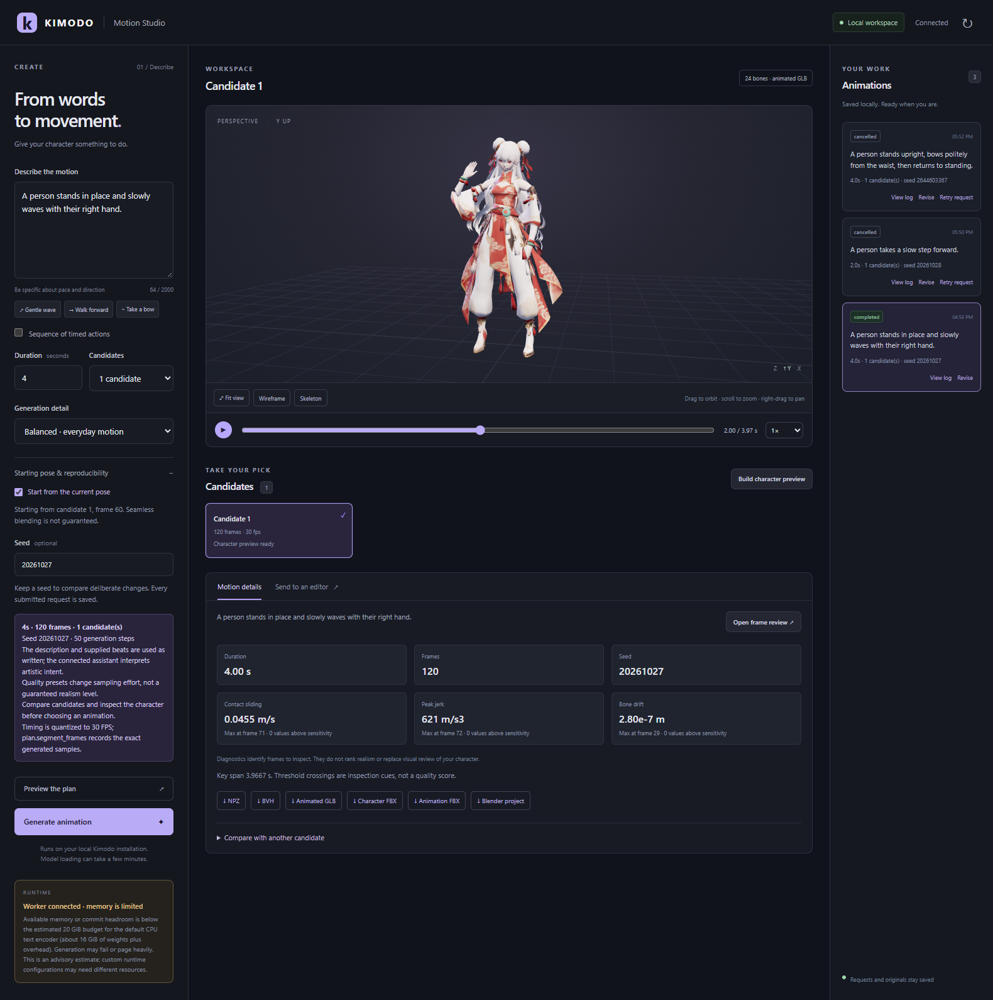
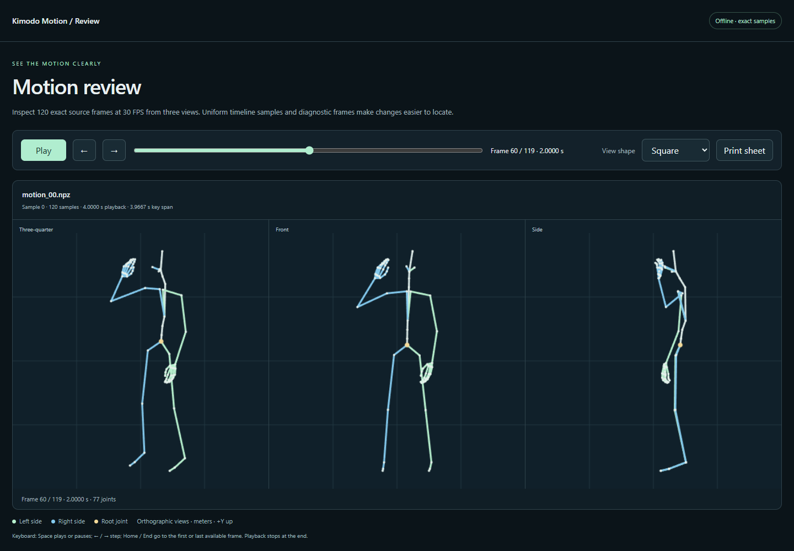

# Local animation studio

The studio is a local browser interface to the same planning, jobs, diagnostics, and editor operations exposed by Kimodo MCP. It lets you move from a description to reviewed animation without manually copying requests between tools.

MCP clients can use `get_capabilities`, `get_workspace_state`, and `get_workflow` to discover the same workspace and complete workflows. `build_character_preview`, saved Unreal targets, and verified output listing are shared operations, available directly through MCP as well as the studio. The browser owns interactive camera and playback controls. See [the agent workflow guide](agent-workflows.md) for discovery, selected-frame inspection, reusable constraints, and exact tool contracts.

Opening the interface does not download model weights or start inference. A connected studio, an available worker, an installed runtime, authorized models, and sufficient memory are separate readiness conditions.



The screenshots use a completed four-second wave and a separately supplied demonstration character. Source meshes, textures, checkpoints, credentials, and generated motion files are not distributed in this repository. The visible starting-pose plan describes another possible generation; the displayed model remains the selected completed candidate until a new job and preview finish.

## Choose an installation route

### Full Windows setup

Use PowerShell 7+, Git, `uv`, CMake, a working C++ compiler, and Node.js 22.12+. From the repository root:

```powershell
.\scripts\setup_runtime.ps1 -DataDirectory "D:\KimodoData"
.\scripts\start_studio.ps1 -DataDirectory "D:\KimodoData" -UpstreamDirectory "D:\KimodoData\upstream-kimodo" -StartWorker -OpenBrowser
```

The first script creates the bridge and inference environments. The second expects those environments at `mcp-env\Scripts\python.exe` and `runtime\Scripts\python.exe` under the data directory. Installing only a repository `.venv` does not satisfy this launcher's layout.

For first-run model access, follow the [README's authentication/download steps](../README.md#getting-started-on-windows). The studio launcher starts an offline worker when requested. It does not grant gated-model access, configure credentials, or change an already running worker's download permission.

| Launcher option | Behavior |
| --- | --- |
| `-DataDirectory` | Required external job/environment directory. |
| `-UpstreamDirectory` | Reviewed Kimodo checkout; needed to start a worker when not already configured. |
| `-StartWorker` | Starts or reuses the independent worker through the worker helper. |
| `-Build` | Installs locked frontend dependencies and rebuilds the UI even when a build exists. |
| `-Port` | Local HTTP port, default `8768`. |
| `-OpenBrowser` | Opens the studio after startup or when reusing an existing instance. |

The launcher reuses an existing studio only if it serves the same data directory. It launches no editor, closes no other application, and installs no operating-system service. Its process ID and stdout/stderr logs are stored beneath the selected data directory.

### Manual source installation

After installing the Python bridge, build the interface:

```powershell
cd web
npm ci
npm run build
cd ..
```

Set the same environment used by the worker and MCP client, then start the studio with the bridge Python:

```powershell
$env:KIMODO_DATA_DIR = "D:\KimodoData"
$env:KIMODO_REPO = "D:\KimodoData\upstream-kimodo"
$env:KIMODO_PYTHON = "D:\KimodoData\runtime\Scripts\python.exe"
$env:TEXT_ENCODER_DEVICE = "cpu"
$env:HF_HOME = "D:\KimodoData\cache\huggingface"

.\.venv\Scripts\python.exe -m kimodo_mcp.studio --web-directory web/dist
```

Open **[http://127.0.0.1:8768](http://127.0.0.1:8768)**. Use `--port 8769` to change ports. On macOS/Linux, substitute the appropriate environment paths and `.venv/bin/python`.

Run the independent worker in another terminal with the same configuration:

```powershell
.\.venv\Scripts\python.exe -m kimodo_mcp.worker_service
```

Keep that process running. Closing the studio tab or an MCP client does not stop it. Restart after reboot or relevant configuration changes.

### Packaged and development builds

The web build writes both `web/dist` and the generated `src/kimodo_mcp/studio_web` package directory. Build the frontend before building a Python wheel. An installed wheel can serve its bundled UI; a source checkout can use `web/dist`. `--web-directory` explicitly selects a build and avoids ambiguity.

Browser code and Three.js are bundled locally with complete renderer and build-runtime notices, including Vite, Rolldown, and their preserved third-party attributions. The running interface needs no CDN. Node.js is needed to build the UI, not to serve a completed packaged build.

The frontend source lives under `web/src`, with locked dependencies and focused tests. `npm run dev` starts Vite on loopback; its development API proxy targets port 8768. Production validation should use the actual studio server because it also applies the browser resource and request policies.

## Describe and plan

Use the creation panel to describe a complete physical action. Include pace, direction, and relevant starting conditions:

> A person stands in place and slowly waves with the right hand.

For one action, select 0.2–10 seconds, one to four candidates, and the generation effort. The presets fill the description; they do not secretly add constraints.

| Effort | Steps | Intended use |
| --- | ---: | --- |
| Draft | 20 | Explore an action with less sampling work. |
| Balanced | 50 | Default sampling effort. |
| Detailed | 80 | Try additional sampling effort on an idea. |

These are compute presets, not guaranteed quality levels. A low-step preset still loads the text encoder.

**Preview the plan** shows exact frame count, seed, sampling steps, candidate count, and notes. No inference begins. When the studio's seed is blank, it chooses a fresh integer and shows it after planning. Generating from that unchanged form retains the displayed seed. Direct MCP briefs use seed zero by default.

Planning preserves the text as written. Kimodo interprets the action during generation; the bridge itself does not contain a separate natural-language parser that invents choreography, discovers a new character rig, or turns “make it better” into precise edits.

### Timed sequences

Enable **Sequence of timed actions** to author two to eight beats. Each beat contains its own description and 0.2–10-second duration. The overall description becomes scene context; the individual beats are the model prompts.

| Beat | Example | Duration |
| --- | --- | ---: |
| 1 | A person walks forward at a relaxed pace. | 3 seconds |
| 2 | A person slows down and comes to a stop. | 2 seconds |
| 3 | A person stands in place and waves with the right hand. | 3 seconds |

The interface shows total duration and the plan records whole-frame timing at 30 FPS. The single-action duration field is disabled in sequence mode. Timing remains authored explicitly; transitions can affect the performance near boundaries.

## Generate and manage jobs

**Generate animation** submits a durable job and returns immediately. The right-hand history shows its saved description, duration, candidate count, seed, status, and current worker stage.

| State | Meaning |
| --- | --- |
| Queued | Saved and waiting for its generation slot. |
| Running | The worker is loading, generating, postprocessing, or exporting. |
| Cancelling | Cancellation has been requested and is being handled. |
| Completed | Expected outputs passed completion/manifest checks and are available. |
| Failed | Work stopped with an error; the saved request and diagnostic log remain. |
| Cancelled | Work was deliberately stopped. |
| Interrupted | The previously active process is no longer running. |

Progress uses real worker stages. It does not invent a percentage or an ETA for model loading. **View log** opens a bounded plain-text diagnostic tail. Failure messages are shown as text, not interpreted as page markup.

**Cancel** requests cancellation. **Retry request**, available for failed/cancelled jobs, resubmits the saved request; it does not silently simplify the action or change its seed. A retry still needs model access and sufficient memory.

All clients using the same data directory share job history. GPU work is serialized, so opening several clients does not make one GPU execute all jobs simultaneously.

## Revisions and starting poses

### Revise an existing request

Select **Revise** on a saved job. The form loads its existing description/beats and settings. Edit the fields you intend to change; unchanged settings remain preserved, including original values that differ from a preset's default step count.

**Preview the plan** previews the revision. **Generate revision** creates a new job with parent-job context. The original request and artifacts remain available. Rewriting a prompt generates a new performance; unmentioned limbs are not guaranteed to remain identical.

For multi-beat work, edit the explicit beats. If timing changes conflict with existing constraints, the server refuses to silently move them. Use a deliberate constraint-clearing revision or a new structured request through the MCP interface.

### Start from the current pose

1. Select a completed SOMA candidate with its matching loaded character preview.
2. Pause or scrub to the desired pose.
3. Open **Starting pose & reproducibility** and enable **Start from the current pose**.
4. Describe a new action and preview the plan.

The checkbox is available only for new generation with a completed, matching source preview. It is disabled while revising to avoid mixing two editing models.

The chosen source frame is rounded from playback time × recorded FPS and clamped to the valid zero-based range. Source frame 60 at 30 FPS is two seconds into the original motion. The server resolves and verifies the original NPZ and adds a destination-frame-zero anchor; it does not extract pose data from rendered screen pixels.

Pose, hand/foot orientations, heading, and world root position are retained as described by the anchor contract. Velocity continuity and seamless blending are not guaranteed. See [pose reuse](natural-workflow.md#reuse-a-selected-pose) for full-body/limb constraints and representation limits.

## View the actual character

A registered opening preview is an existing GLB. Its presence does not imply that a new prompt has finished. Selecting a completed candidate loads its verified managed preview when available. Otherwise, the stage explicitly offers to build one.

**Build character preview** prepares and executes the supported character handoff in Blender, then returns the exported GLB and receipt. Repeating a completed matching request can reuse its checked output. When several valid attempts exist, the studio selects the newest verified attempt for that sample.

The viewer does not keep the previous candidate visible beneath a failed new load. Missing geometry or embedded texture resources produce an explicit error.

| Control | Effect |
| --- | --- |
| Drag | Orbit around the model. |
| Scroll | Zoom. |
| Right-drag | Pan. |
| Fit view | Frame the currently loaded model. |
| Play/pause | Play the GLB animation; playback stops at its last key. |
| Timeline | Scrub through the actual animation. |
| Speed | Change viewing speed without modifying exported motion. |
| Wireframe | Inspect mesh structure. |
| Skeleton | Show the fitted rig overlay. |

The GLB is a retargeted character representation. It can reveal deformation problems that a skeleton-only plot cannot, but it does not add cloth, hair, facial, or independent finger simulation.

### Register a character and opening preview

The current fitted profile requires one exact inspected source asset. It does not accept arbitrary characters. The demonstration asset is not included, and changing the path does not bypass its checksum validation.

The operator can set `KIMODO_CHARACTER_FBX` or create `character/target.json` beneath the data directory:

```json
{
  "schema_version": 1,
  "source_fbx": "D:/Assets/supported-character.fbx",
  "preview_glb": "D:/Assets/existing-character-preview.glb"
}
```

Use actual absolute local paths. `preview_glb` optionally supplies an opening preview; it is distinct from a selected job's verified managed output. Do not commit registration files or original assets.

For generic skeleton work, use Kimodo NPZ reviews and the SOMA BVH handoff. Extending fitting to another character requires deliberate implementation and visual validation of that rig, rest pose, proportions, and weights.

## Inspect and compare motion

The detail panel shows duration, frame count, seed, and selected diagnostics. **Open frame review** opens a standalone report with the exact source poses, fixed full-clip camera bounds, front/side/three-quarter views, and a contact sheet combining timeline samples with diagnostic extrema.



The screenshot shows the original 77-joint motion, while the studio character uses its separate fitted 24-bone rig. These are different views of the same performance, not an assertion that their joint counts are identical.

Diagnostics include speed, acceleration, jerk, angular speed, bone-length drift, supported foot-contact sliding, floor proxies, and endpoint seams. Each metric states units and availability. Thresholds identify frames to inspect; they are not universal realism tests or an automatic winner. Joint floor tests do not establish mesh collision, and contact metrics depend on correct labels.

### Compare candidates

Expand **Compare with another candidate**, choose another completed job/sample, and set:

- **Frame offset:** positive values compare the first clip's frame `i` to the second clip's `i + offset`.
- **World position:** retain root movement and drift.
- **Relative to root:** subtract each frame's root translation only, keeping heading and scale unchanged.

Both clips require matching FPS, skeleton, names, and hierarchy, and the offset must leave an overlapping range. The server does not implicitly resample, retarget, or time-warp inputs. The returned page uses shared full-clip camera bounds so framing does not hide differences.

A 120-sample motion at 30 FPS has four seconds of sample playback and a 3.966667-second first-to-last key span. The reports label these separately; Unreal normally exposes the latter span.

See [motion review](animate-review.md) for metric definitions, canonical hashes, limits, and deterministic-frame verification.

## Download or send to an editor

The download row lists only verified files available for the selected job/sample:

| File | Purpose |
| --- | --- |
| Native NPZ | Original Kimodo motion arrays and metadata. |
| BVH / CSV / AMASS | Supported skeleton-specific native interchange. |
| Animated GLB | Self-contained fitted character preview with its animation and embedded textures. |
| Character FBX | Rest-pose skeletal mesh for creating the matching target rig. |
| Animation FBX | Baked animation for that rig. |
| Blender project | Separate saved scene with the fitted character and motion. |

Not every model or job produces every format. Original NPZ and exported character files are distinct artifacts.

### Blender

The tested editor connection is [Blender Lab MCP](https://www.blender.org/lab/mcp-server/) v1.0.3 with Blender 5.2.1. It listens locally on port 9876. Install and configure the official compatible addon; another similarly named connector may implement a different protocol.

**Prepare & run** uses the fixed character pipeline through that connection. It preserves the original asset, saves separate outputs, and validates the result. The generic skeleton template has a separate fresh-session requirement when `KimodoRig` already exists.

### Unreal

In **Send to an editor**, configure all five target fields:

| Field | Example |
| --- | --- |
| Project file | `D:/Projects/AnimationLab/AnimationLab.uproject` |
| Skeleton asset | `/Game/Characters/Character_Skeleton` |
| Skeletal mesh | `/Game/Characters/Character` |
| Destination | `/Game/Animations` |
| New animation name | `Wave_01` |

These must identify an actual open project and matching imported rig. Import the exported skeletal mesh first. Then **Import into Unreal** prepares and executes the fixed animation-only handoff and checks the saved result. Existing destination assets are not silently replaced.

To prefill those fields locally, create `studio.json` under the data directory:

```json
{
  "unreal_target": {
    "project_file": "D:/Projects/AnimationLab/AnimationLab.uproject",
    "skeleton_path": "/Game/Characters/Character_Skeleton",
    "skeletal_mesh_path": "/Game/Characters/Character",
    "destination_path": "/Game/Animations",
    "asset_name": "Wave_01"
  }
}
```

Engine registration, required plugins, Python remote execution, native Unreal MCP, hierarchy checks, and report behavior are documented in [editor handoffs](editor-handoffs.md). Native MCP reachability alone is not sufficient for the Python import step.

## Memory and connection status

The runtime card distinguishes an available worker from sufficient generation memory. The default Llama 8B encoder on CPU needs roughly 16 GB for bfloat16 weights alone, plus overhead. Shorter clips and draft steps do not eliminate that requirement. The worker does not maintain a persistent embedding cache.

`health.capacity` reports:

| Field | Interpretation |
| --- | --- |
| `available_memory_gib` | Available physical memory, or `null` when unknown. |
| `commit_headroom_gib` | Remaining estimated commit capacity, or `null` when unknown. |
| `cpu_text_encoder_warning` | Advisory when the default CPU-encoder budget appears insufficient. |

Windows reports physical availability and commit headroom; Linux uses `/proc/meminfo`. Either known value below the estimated 20 GiB CPU-encoder budget can produce an advisory. It does not block submission or account for every custom configuration. Unsupported readings are unknown rather than zero.

The API also exposes `health.editors.blender.reachable` and `health.editors.unreal.reachable`. These are cached TCP-listener checks on loopback ports 9876 and 8000, with 0.2-second timeouts. They execute no commands and do not verify the intended project, compatible rig, or Unreal Python transport.

No applications are closed automatically to reclaim memory. Review existing results until adequate resources are configured.

## Local API and file boundaries

| Endpoint | Purpose |
| --- | --- |
| `GET /api/state` | Jobs, verified previews/downloads, character registration, targets, health, and the per-process action token. |
| `GET /api/jobs/{id}` | One job's current details. |
| `POST /api/actions/{tool}` | An allowlisted operation using the same validated contracts as the MCP tools. |
| `GET /api/files/{job_id}/{relative_path}` | Recognized managed output files, subject to containment and verification checks. |
| `GET /api/character/model.glb` | The locally registered opening preview when available. |

Browser actions use the token from the current studio process. A server restart changes it; refresh the page after restarting. Other origins/hosts are rejected. File routes do not expose arbitrary filesystem paths, and actions do not accept arbitrary shell commands or editor Python.

The interface binds to `127.0.0.1`. It is intended for a trusted local desktop, not public hosting or untrusted multi-user access. Do not expose it through a tunnel or reverse proxy without designing the corresponding authentication and authorization boundary.

The browser resource policy allows local scripts/styles and embedded GLB image resources. Texture loading uses local blob URLs; their permitted fetch path is needed for faithful materials. No CDN is used.

## Recovery and verification

| Situation | Next step |
| --- | --- |
| Assets missing | Rebuild in `web`, then use the correct `--web-directory` or packaged build. |
| Worker unavailable | Start the worker with the same data directory and read its service error log. |
| Model access denied | Check gated access, local runtime login/cache, and worker download permission. |
| Failed job | Read its log, correct the actual cause, then retry the saved request or create a revision. |
| Preview failed | Check the character profile, Blender connection, source checksum, and managed report. |
| Uncertain editor timeout | Inspect the report before retrying; a delayed import may already have completed. |
| Unreal rejects hierarchy | Use the mesh/Skeleton created from the same rig, or retarget explicitly first. |
| Changed artifact no longer appears | Treat it as a provenance failure; inspect the source/export rather than assuming the old receipt still applies. |
| Revision rejects timing | Preserve timing or explicitly revise/clear constraints through the structured workflow. |

Live validation used actual API responses and the real GLB: textured rendering, camera/timeline controls, preserved revisions, pose-anchor planning, timed beats, diagnostics, comparison, downloaded NPZ checksum, worker logs, Blender receipt reuse, and a saved Unreal import. Desktop and narrow layouts were visually inspected with no browser console or page errors.

The publication checks reused a completed motion and did not submit fresh inference under insufficient available memory. The separately verified queue/cancel path stopped before model inference. Neither a valid plan nor a connected worker is evidence that a new animation has finished.
